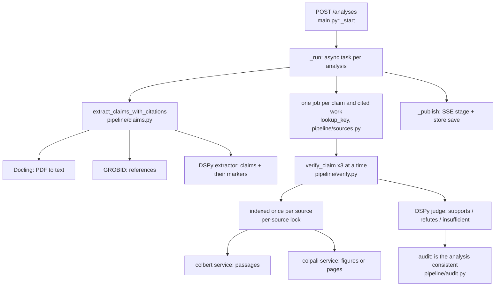
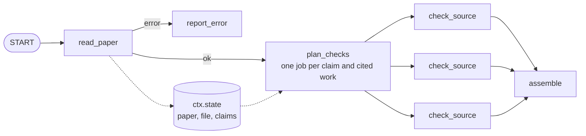

# Architecture

SecretSource reads a research paper, pulls out the claims that cite other work, and checks
each claim against the paper it cites. This document covers how the parts fit together:
which entry point serves the product, what the pipeline actually calls, and where a change
belongs.

## Three entry points, one pipeline

The same pipeline modules are driven three different ways. Only the first one serves the
web app.

| Entry point | Code | Used by | Emits SSE |
| --- | --- | --- | --- |
| HTTP gateway | `backend/app/main.py` (`_run`) | the frontend, `POST /analyses` | yes |
| Analysis graph | `backend/app/workflow.py` | `adk web`, via `backend/adk_agents/analysis` | no |
| Chat tree | `backend/app/agents/team.py` | `backend/cli.py`, and `adk web` via `backend/adk_agents/chat` | no |

`backend/adk_agents/analysis` and `backend/adk_agents/chat` are two-line modules that
re-export `analysis_workflow` and `root_agent` under the names ADK's dev UI expects
(`docker compose --profile dev up -d adk-web`, then port 8001).

For a product-facing fix, change the gateway. The graph and the chat tree are development
and exploration surfaces; the graph is intended to eventually back the gateway (see
`workflow.py`'s own docstring), but does not today.

## What a run does



Stage by stage:

1. `_start` creates the analysis (a 12-character id), registers a stream queue, and spawns
   `_run` as a task. The response is just `{"id"}`; everything after is watched over SSE.
2. `extract_claims_with_citations` (`pipeline/claims.py`) converts the PDF with Docling,
   parses the bibliography from GROBID's TEI, asks a DSPy extractor for claims that cite
   something, and locates each claim's sentence back in the PDF (`locate`, giving page and
   boxes) so the viewer can show the place rather than describe it.
3. Every claim and cited work that resolves to something lookupable (`lookup_key`) becomes
   one job, and the jobs run through `asyncio.gather` behind a `Semaphore(PARALLEL_CHECKS)`.
   `verify_claim` downloads and indexes the cited paper, retrieves the passages that bear
   on the claim, and asks the judge.
4. `audit` reads the assembled analysis before it is marked done and reports where it
   disagrees with itself — most usefully, a verdict whose quote is not in the evidence that
   verdict was given. It reports; it never rewrites a verdict.
5. Every step calls `_publish`, which appends a stage to the analysis, saves it, and pushes
   it onto that analysis's queue for `GET /analyses/{id}/events`.

Both entry points now check three sources at a time: the gateway with that semaphore, the
graph with `max_parallel_workers=PARALLEL_CHECKS`. Extraction is concurrent too — a paper
is split into windows and `claims.py` maps them over a thread pool capped at
`EXTRACT_WORKERS`, since each window is its own model call.

Stages arrive in whatever order the checks finish rather than in claim order, which is why
every stage names its own claim.

## Verification, in detail

`verify_claim(claim, source_pdf_path)` in `backend/app/pipeline/verify.py`:

1. `local_pdf` resolves the source — a local path, or a DOI / arXiv ID / PMID / URL that
   `pipeline/sources.py` looks up (arXiv directly; otherwise Semantic Scholar, then
   Unpaywall) and downloads into `PAPERS_DIR`.
2. `_index_once` indexes it in the ColBERT service (text passages) and, when the service is
   up, the ColPali service (cropped figures, or whole rendered pages when no figures could
   be cropped) — once per process, behind a per-source lock. Both stores replace a source
   rather than merge into it, so without that lock a second check could search a source
   while the first sat between its delete and its upsert, retrieve nothing, and report the
   claim unsupported.
3. `_evidence` retrieves passages for the claim from ColBERT, filtered to that source.
   `_visual` retrieves matching figures or pages from ColPali; their captions are folded
   into the evidence, since a caption is a line the judge can read and quote.
4. The judge decides. The verdict also carries `indexed_in`, which index resolved the work
   and the ids it gave, read back from the resolution cache at no extra request. Failures
   return `status: "error"` with a `reason`, which `unchecked_reason` maps to a code the UI
   can show — a claim nobody could check must not look like one nobody tried.

The judge is a DSPy `ChainOfThought` over a `JudgeClaim` signature, built lazily inside
`_build_judge` and cached in a module global. It is not an ADK agent node: no graph node
and no chat agent decides a verdict, they all call this same function.

## The two graphs

### The chat tree

`backend/app/agents/team.py`. A root LLM agent that only routes, three specialists that only
work. Dashed edges are delegation — the coordinator handing the conversation over with
`transfer_to_agent`; solid edges are an agent calling one of its own tools.


Every specialist is an `LlmAgent` with its own instruction and its own tools, and the
coordinator's instruction forbids it from answering anything itself. The tools are the same
functions the gateway calls directly, which is why a fix in `app/pipeline` reaches all three
entry points at once.

### The analysis graph

`backend/app/workflow.py`. Not an agent tree: plain functions as nodes, with one node that
fans out. `read_paper` returns a routed `Event`, so the graph branches on `ok` / `error`.



`check_sources` is one node declared with `parallel_worker=True` and
`max_parallel_workers=PARALLEL_CHECKS` (3); the three boxes above are that node's workers,
not three separate nodes. `assemble` folds verdicts and failures back onto their claims the
same way `_run` does. Session state carries the run between nodes — `read_paper` writes
`paper`, `file` and `claims`; the session key `verify` set to false makes `plan_checks`
return nothing, which stops the run after extraction.

### ADK patterns, mapped

For a reader arriving from Google's ADK multi-agent guide, this system uses:

| Pattern | Where |
| --- | --- |
| LLM-driven delegation (coordinator / dispatcher) | `team.py`: `sub_agents=[...]` on the root, routing by `transfer_to_agent` |
| Shared session state | `workflow.py`: `ctx.state["paper" / "file" / "claims"]`, and the `verify` key |
| MCP toolsets | DuckDuckGo over stdio, the colbert service over streamable HTTP at `/mcp` |
| Parallel fan-out | `workflow.py`: the `check_sources` worker node |

And deliberately does not use `AgentTool` (no agent is wrapped as another agent's tool),
`LoopAgent` (nothing iterates to a condition), or the `SequentialAgent` / `ParallelAgent`
classes — the analysis pipeline is a `Workflow` graph of functions instead, because its
steps are deterministic and only the judge inside `verify_claim` needs a model.

## Services

| Service | What it does | Where it runs |
| --- | --- | --- |
| `colbert` | ColBERT passage index and search; also serves MCP at `/mcp` | `services/colbert`, GPU profile locally, Cloud Run in the cloud |
| `colpali` | ColQwen2 index over figure crops and rendered pages | `services/colpali`, vision profile locally, Cloud Run in the cloud |
| `grobid` | Reference parsing from the PDF | compose container, port 8070 |
| `qdrant` | Vector store behind both retrieval services | compose container locally, a GCE VM in the cloud |
| LLM endpoint | One OpenAI-compatible server behind both frameworks | compose `vllm`, or whatever `VLLM_URL` points at |
| `gateway` | The HTTP API above | `backend/`, port 8080 |
| `web` | Built frontend served by nginx, proxying `/api` to the gateway | `frontend/`, port 5173 |
| `a2a` | The chat tree over A2A, for callers that are agents | `backend/a2a_server.py`, port 8002, `--profile a2a` |

`backend/app/llm.py` is the single place the model is configured: ADK agents get a
`LiteLlm`, DSPy programs get a `dspy.LM`, both pointed at `VLLM_URL`. `backend/app/config.py`
reads every setting from the environment, and `.env` covers host runs and compose alike, so
pointing `COLBERT_URL` / `COLPALI_URL` / `VLLM_URL` at deployed services replaces the local
containers without a code change.

`web` and `gateway` are built images with no source mount, so a code change needs
`docker compose up -d --build <service>`. For iteration, run that one service on the host
instead (`npm run dev`, or `uvicorn app.main:app --reload`) and let the rest stay in compose.

## Two ways in for machines

The retrieval services speak **MCP** at `/mcp/` alongside their HTTP API, which is
tool-level access: a client calls `search_passages` and gets passages back. The trailing
slash matters — `/mcp` redirects.

The `a2a` service speaks **A2A**, which is agent-level access: a caller sends a task in
natural language and the coordinator decides which specialist handles it. It serves an
agent card describing the whole tree, so a client discovers the skills rather than being
told them:

```sh
docker compose --profile a2a up -d a2a
curl http://localhost:8002/.well-known/agent-card.json

curl -X POST http://localhost:8002/ -H 'Content-Type: application/json' -d '{
  "jsonrpc": "2.0", "id": "1", "method": "message/send",
  "params": {"message": {"messageId": "1", "role": "user",
    "parts": [{"kind": "text", "text": "List the claims in data/papers/paper.pdf"}]}}}'
```

The reply is a task with `status.state` and the answer as an artifact. `A2A_HOST` and
`A2A_PORT` set the URL the card advertises back to callers, which has to be an address
they can actually reach — `a2a:8002` from another compose service, `localhost:8002` from
the host.

## State

A running analysis lives in the `analyses` dict in `main.py`, with an `asyncio.Queue` per
analysis in `streams` for its SSE listeners. Every `_publish` also writes the whole analysis
to SQLite through `backend/app/store.py`, so history survives a restart; `restore()` reloads
them at startup and marks anything still "running" as interrupted.

`store.py` keeps whole analyses as JSON — the gateway reads and writes them entire, never in
parts — and separately caches resolved sources (`remember_source` / `recall_source`) so a
re-run costs no lookup API call.

## Where to change what

| Change | Where |
| --- | --- |
| Anything the web app does | `backend/app/main.py` and `frontend/src` |
| How claims are found, or where a sentence sits in the PDF | `backend/app/pipeline/claims.py` |
| How a citation resolves to a downloadable PDF | `backend/app/pipeline/sources.py` |
| What counts as evidence, or how a verdict is decided | `backend/app/pipeline/verify.py` |
| Figure and table extraction | `backend/app/pipeline/figures.py` |
| Retrieval behaviour (chunking, batching, collections) | `services/colbert`, `services/colpali` |
| The model, or how it is addressed | `backend/app/llm.py`, `backend/app/config.py` |
| The graph drawn by `adk web` | `backend/app/workflow.py` |
| The chat specialists and their routing | `backend/app/agents/team.py` |
