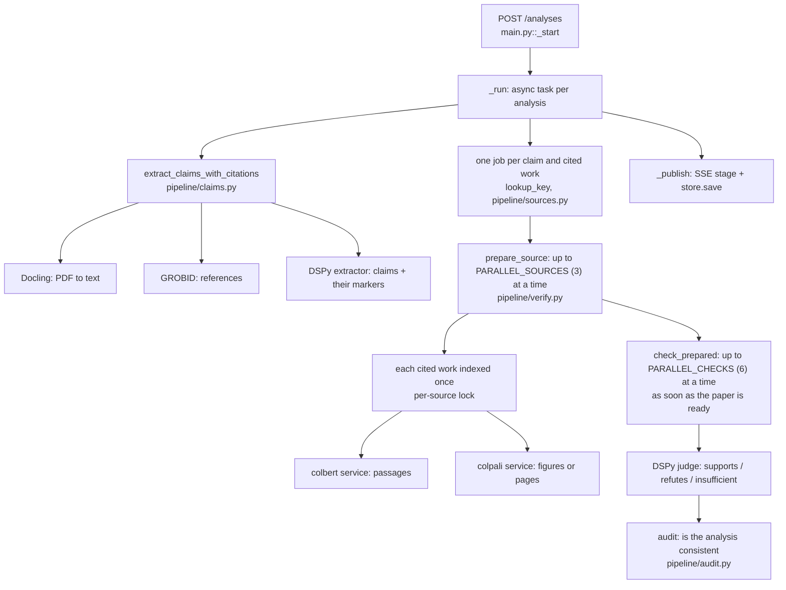
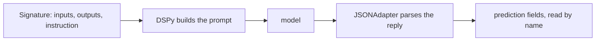
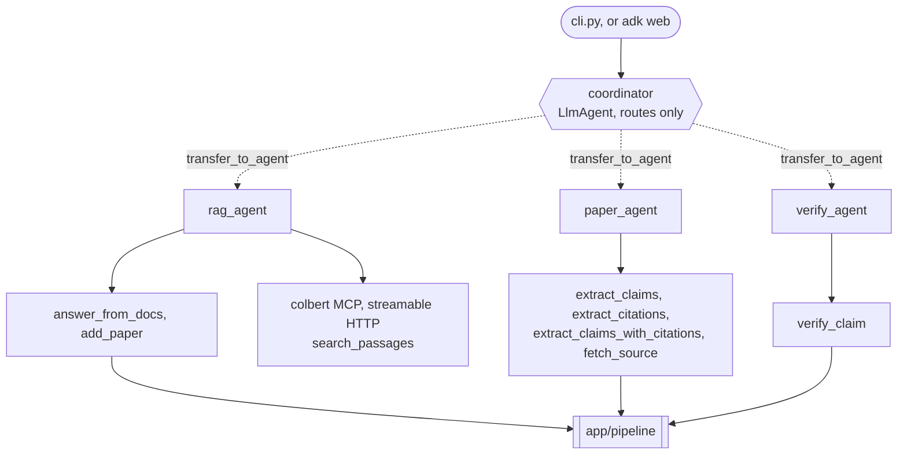
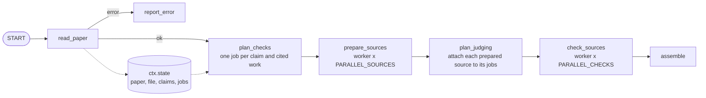

# Architecture

SecretSource reads a research paper, pulls out the claims that cite other work, and checks
each claim against the paper it cites. This document covers how the parts fit together:
which entry point serves the product, what the pipeline actually calls, and where a change
belongs.

## Three entry points, one pipeline

The same pipeline modules are driven three different ways. Only the first one serves the
web app.

| Entry point | Code | Used by | Emits SSE |
| --- | --- | --- | --- |
| HTTP gateway | `backend/app/main.py` (`_run`) | the frontend, `POST /analyses` | yes |
| Analysis graph | `backend/app/workflow.py` | `adk web`, via `backend/adk_agents/analysis` | no |
| Chat tree | `backend/app/agents/team.py` | `backend/cli.py`, and `adk web` via `backend/adk_agents/chat` | no |

`backend/adk_agents/analysis` and `backend/adk_agents/chat` are two-line modules that
re-export `analysis_workflow` and `root_agent` under the names ADK's dev UI expects
(`docker compose --profile dev up -d adk-web`, then port 8001).

For a product-facing fix, change the gateway. The graph and the chat tree are development
and exploration surfaces. The graph is intended to eventually back the gateway (see
`workflow.py`'s own docstring), but does not today.

## What a run does



Stage by stage:

1. `_start` creates the analysis (a 12-character id), registers a stream queue, and spawns
   `_run` as a task. The response is just `{"id"}`; everything after is watched over SSE.
2. `extract_claims_with_citations` (`pipeline/claims.py`) converts the PDF with Docling,
   parses the bibliography from GROBID's TEI, asks a DSPy extractor for claims that cite
   something, and locates each claim's sentence back in the PDF (`locate`, giving page and
   boxes) so the viewer can show the place rather than describe it.
3. Every claim and cited work that resolves to something lookupable (`lookup_key`) becomes
   one job. Each cited work is prepared once by `prepare_source`, even if many claims cite
   it: download the PDF if needed, then index it in ColBERT and ColPali at the same time.
   Up to `PARALLEL_SOURCES` papers (default 3) are prepared at the same time, because
   indexing uses the GPU services.
4. As soon as a paper is ready, its claims are judged by `check_prepared`, up to
   `PARALLEL_CHECKS` claims (default 6) at a time. Judging searches ColBERT and ColPali at
   the same time, then asks the LLM judge. Both numbers are environment variables read in
   `backend/app/config.py`.
5. `audit` reads the assembled analysis before it is marked done and reports where it
   disagrees with itself. Most usefully, a verdict whose quote is not in the evidence that
   verdict was given. It reports; it never rewrites a verdict.
6. Every step calls `_publish`, which appends a stage to the analysis, saves it, and pushes
   it onto that analysis's queue for `GET /analyses/{id}/events`.

Both entry points use the same limits: the gateway prepares up to `PARALLEL_SOURCES`
papers and judges up to `PARALLEL_CHECKS` claims at a time, and the graph declares the
same two numbers as its worker limits. Extraction is concurrent too. A paper is split into
windows and `claims.py` maps them over a thread pool capped at `EXTRACT_WORKERS`, since
each window is its own model call.

Stages arrive in whatever order the checks finish rather than in claim order, which is why
every stage names its own claim.

## Verification, in detail

`verify_claim(claim, source_pdf_path)` in `backend/app/pipeline/verify.py` is the ADK tool
and what `POST /verify` uses. It now calls two functions in order:

1. `prepare_source(source_pdf_path)` gets the cited work ready. `local_pdf` resolves the
   source: a local path, or a DOI / arXiv ID / PMID / URL that `pipeline/sources.py` looks
   up (arXiv directly; otherwise Semantic Scholar, then Unpaywall) and downloads into
   `PAPERS_DIR`. Then `_index_once` indexes it in the ColBERT service (text passages) and,
   when the service is up, the ColPali service (cropped figures, or whole rendered pages
   when no figures could be cropped). Both indexes are built at the same time. The work is
   done once per paper, behind a per-source lock, so calling it again for the same paper
   costs nothing. Both stores replace a source rather than merge into it, so without that
   lock a second check could search a source while the first sat between its delete and
   its upsert, retrieve nothing, and report the claim unsupported.
2. `check_prepared(claim, source_pdf_path, source)` judges the claim against the prepared
   paper. It retrieves passages for the claim from ColBERT, filtered to that source
   (`_evidence`), and retrieves matching figures or pages from ColPali (`_visual`). The two
   searches run at the same time. The
   caption of each figure is folded into the evidence, since a caption is a line the judge
   can read and quote. Then the judge decides.

The verdict also carries `indexed_in`, which index resolved the work and the ids it gave,
read back from the resolution cache at no extra request. Failures return `status: "error"`
with a `reason`, which `unchecked_reason` maps to a code the UI can show. A claim nobody
could check must not look like one nobody tried.

The judge is a DSPy `ChainOfThought` over a `JudgeClaim` signature, built lazily inside
`_build_judge` and cached in a module global. It is not an ADK agent node: no graph node
and no chat agent decides a verdict, they all call this same function.

## How DSPy is used

DSPy is a Python library for calling a language model from code. Instead of writing a
prompt string and parsing the reply by hand, you describe the task as a `dspy.Signature`:
named input fields and named output fields, a short instruction (the class docstring), and
a description for each field. DSPy turns that into the prompt, calls the model, and hands
back an object whose output fields you read directly, for example `prediction.verdict`.

Google ADK runs the agents and the order of the steps: the chat agent tree
(`backend/app/agents/team.py`) and the analysis graph (`backend/app/workflow.py`). DSPy
sits inside the steps. It handles each single call to the model that must return
structured data. Both use the same model. `backend/app/llm.py` builds `adk_model()` for
ADK and `dspy_lm()` for DSPy. `dspy_lm()` is a `dspy.LM("openai/<VLLM_MODEL>")` pointed at
`VLLM_URL`, so it works with any OpenAI-compatible endpoint. It also sends
`enable_thinking: false`. A Qwen3 model that "thinks" can spend its whole token budget on
reasoning and return an empty answer ("The LM returned an empty or null response.").

There are four DSPy programs in the code:

| Program (Signature) | File | Inputs to outputs | Used by |
| --- | --- | --- | --- |
| `ExtractCitedClaims` | `backend/app/pipeline/claims.py` | a part of the paper text, with citation markers like `[b12]` to a list of claims, each with its markers and the exact sentence copied from the paper | the analysis pipeline (`extract_claims_with_citations`); the paper is split into parts and up to 3 parts run at the same time |
| `ExtractClaims` | `backend/app/pipeline/claims.py` | a part of a paper to 3 to 6 short claims | the `extract_claims` agent tool |
| `JudgeClaim` | `backend/app/pipeline/verify.py` | a claim and passages from the cited paper (ColBERT passages, plus figure captions from ColPali) to a verdict (supports / refutes / insufficient), the quote that decides it, and one sentence of reasoning | every check in an analysis, and `POST /verify` |
| `GenerateAnswer` (inside a `dspy.Module` called RAG) | `backend/app/pipeline/rag.py` | a question and passages from ColBERT to a short answer | the `answer_from_docs` agent tool |

All four use `dspy.ChainOfThought`, which asks the model to reason step by step before it
fills the output fields.



Choices in the code, and why:

- `dspy.JSONAdapter()` (in both claim extractors and the judge, not in the RAG answer): the
  model must answer in JSON that DSPy parses. The code comment
  explains why: without it the model split the claim list across lines and only one claim
  parsed.
- Output types: `ExtractCitedClaims` returns a list of `CitedClaim` objects, a pydantic
  model with `claim` and `sentence`. The sentence is copied word for word, so `locate` in
  `claims.py` can find it in the PDF and the UI can highlight it. The `[bN]` markers link
  each claim to its references from GROBID.
- The judge runs with `temperature=0.0` and `max_tokens=1000`, so the same input gives the
  same verdict as far as possible. If the model returns a verdict that is not one of the
  three labels, the code uses "insufficient".
- `dspy.context(lm=..., adapter=...)` wraps each call instead of `dspy.configure(...)`.
  `dspy.context` is safe when several threads run at the same time, and the pipeline judges
  several claims in parallel threads. `dspy.configure` is not safe for that.

Why DSPy matters here:

- The model's answer comes back as typed fields, not free text. The pipeline needs exact
  values (a verdict label, a quote, a sentence that can be located in the PDF), so this
  removes a lot of fragile parsing code.
- The task is written once as a Signature and works with any OpenAI-compatible model.
  Changing `VLLM_URL` / `VLLM_MODEL` changes the model without rewriting prompts.
- Each LLM step is a small, named program in one place, so it is easy to find, test and
  improve.
- A possible next step, not done yet: DSPy can tune these programs automatically with its
  optimizers, using labelled examples such as the project's benchmark dataset. The code
  does not use an optimizer today.

One thing to be careful about: the Signature's docstring and the field `desc` texts are
the instructions the model reads. Editing them changes the model's behaviour and can
change verdicts. Treat them like code: change them on purpose, and re-check the results on
a known paper.

## The two graphs

### The chat tree

`backend/app/agents/team.py`. A root LLM agent that only routes, three specialists that only
work. Dashed edges are delegation: the coordinator handing the conversation over with
`transfer_to_agent`. Solid edges are an agent calling one of its own tools.



Every specialist is an `LlmAgent` with its own instruction and its own tools, and the
coordinator's instruction forbids it from answering anything itself. The tools are the same
functions the gateway calls directly, which is why a fix in `app/pipeline` reaches all three
entry points at once.

### The analysis graph

`backend/app/workflow.py`. Not an agent tree: plain functions as nodes, with two nodes that
fan out. `read_paper` returns a routed `Event`, so the graph branches on `ok` / `error`.



`prepare_sources` and `check_sources` are each one node declared with
`parallel_worker=True`. `prepare_sources` uses `max_parallel_workers=PARALLEL_SOURCES`
(3) and downloads and indexes each cited work once. `check_sources` uses
`max_parallel_workers=PARALLEL_CHECKS` (6) and judges each claim against its already
prepared work. `assemble` folds verdicts and failures back onto their claims the same way
`_run` does. Session state carries the run between nodes. `read_paper` writes `paper`,
`file` and `claims`; `plan_checks` saves the jobs; the session key `verify` set to false
makes `plan_checks` return nothing, which stops the run after extraction.

### ADK patterns, mapped

For a reader arriving from Google's ADK multi-agent guide, this system uses:

| Pattern | Where |
| --- | --- |
| LLM-driven delegation (coordinator / dispatcher) | `team.py`: `sub_agents=[...]` on the root, routing by `transfer_to_agent` |
| Shared session state | `workflow.py`: `ctx.state["paper" / "file" / "claims" / "jobs"]`, and the `verify` key |
| MCP toolsets | DuckDuckGo over stdio, the colbert service over streamable HTTP at `/mcp` |
| Parallel fan-out | `workflow.py`: the `prepare_sources` and `check_sources` worker nodes |

And deliberately does not use `AgentTool` (no agent is wrapped as another agent's tool),
`LoopAgent` (nothing iterates to a condition), or the `SequentialAgent` / `ParallelAgent`
classes. The analysis pipeline is a `Workflow` graph of functions instead, because its
steps are deterministic and only the judge inside `check_prepared` needs a model.

## Services

| Service | What it does | Where it runs |
| --- | --- | --- |
| `colbert` | ColBERT passage index and search; also serves MCP at `/mcp` | `services/colbert`, GPU profile locally, Cloud Run in the cloud |
| `colpali` | ColQwen2 index over figure crops and rendered pages | `services/colpali`, vision profile locally, Cloud Run in the cloud |
| `grobid` | Reference parsing from the PDF | compose container, port 8070 |
| `qdrant` | Vector store behind both retrieval services | compose container locally, a GCE VM in the cloud |
| LLM endpoint | One OpenAI-compatible server behind both frameworks | compose `vllm`, or whatever `VLLM_URL` points at |
| `gateway` | The HTTP API above | `backend/`, port 8080 |
| `web` | Built frontend served by nginx, proxying `/api` to the gateway | `frontend/`, port 5173 |
| `a2a` | The chat tree over A2A, for callers that are agents | `backend/a2a_server.py`, port 8002, `--profile a2a` |

`backend/app/llm.py` is the single place the model is configured: ADK agents get a
`LiteLlm`, DSPy programs get a `dspy.LM`, both pointed at `VLLM_URL`. `backend/app/config.py`
reads every setting from the environment, and `.env` covers host runs and compose alike, so
pointing `COLBERT_URL` / `COLPALI_URL` / `VLLM_URL` at deployed services replaces the local
containers without a code change.

`web` and `gateway` are built images with no source mount, so a code change needs
`docker compose up -d --build <service>`. For iteration, run that one service on the host
instead (`npm run dev`, or `uvicorn app.main:app --reload`) and let the rest stay in compose.

## Two ways in for machines

The retrieval services speak **MCP** at `/mcp/` alongside their HTTP API, which is
tool-level access: a client calls `search_passages` and gets passages back. The trailing
slash matters: `/mcp` redirects.

The `a2a` service speaks **A2A**, which is agent-level access: a caller sends a task in
natural language and the coordinator decides which specialist handles it. It serves an
agent card describing the whole tree, so a client discovers the skills rather than being
told them:

```sh
docker compose --profile a2a up -d a2a
curl http://localhost:8002/.well-known/agent-card.json

curl -X POST http://localhost:8002/ -H 'Content-Type: application/json' -d '{
  "jsonrpc": "2.0", "id": "1", "method": "message/send",
  "params": {"message": {"messageId": "1", "role": "user",
    "parts": [{"kind": "text", "text": "List the claims in data/papers/paper.pdf"}]}}}'
```

The reply is a task with `status.state` and the answer as an artifact. `A2A_HOST` and
`A2A_PORT` set the URL the card advertises back to callers, which has to be an address
they can actually reach: `a2a:8002` from another compose service, `localhost:8002` from
the host.

## State

A running analysis lives in the `analyses` dict in `main.py`, with an `asyncio.Queue` per
analysis in `streams` for its SSE listeners. Every `_publish` also writes the whole analysis
to the store through `backend/app/store.py`, so history survives a restart; `restore()`
reloads them at startup and marks anything still "running" as interrupted.

The store is SQLite by default. When `SUPABASE_URL` and `SUPABASE_SERVICE_ROLE_KEY` are set
in `.env`, the gateway stores analyses in Supabase Postgres instead. The service role key
bypasses RLS, so it is server-only.

`store.py` keeps whole analyses as JSON. The gateway reads and writes them entire, never in
parts. It also caches resolved sources (`remember_source` / `recall_source`) so a re-run
costs no lookup API call.

## Where to change what

| Change | Where |
| --- | --- |
| Anything the web app does | `backend/app/main.py` and `frontend/src` |
| How claims are found, or where a sentence sits in the PDF | `backend/app/pipeline/claims.py` |
| How a citation resolves to a downloadable PDF | `backend/app/pipeline/sources.py` |
| What counts as evidence, or how a verdict is decided | `backend/app/pipeline/verify.py` |
| Figure and table extraction | `backend/app/pipeline/figures.py` |
| Retrieval behaviour (chunking, batching, collections) | `services/colbert`, `services/colpali` |
| The model, or how it is addressed | `backend/app/llm.py`, `backend/app/config.py` |
| The graph drawn by `adk web` | `backend/app/workflow.py` |
| The chat specialists and their routing | `backend/app/agents/team.py` |
