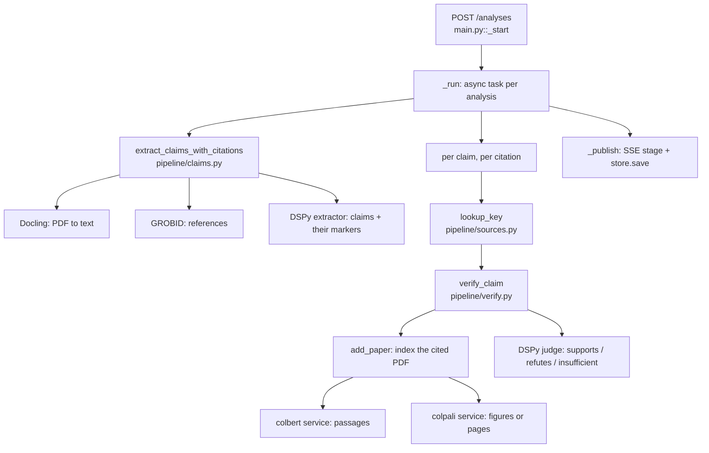

# Architecture

SecretSource reads a research paper, pulls out the claims that cite other work, and checks
each claim against the paper it cites. This document covers how the parts fit together:
which entry point serves the product, what the pipeline actually calls, and where a change
belongs.

## Three entry points, one pipeline

The same pipeline modules are driven three different ways. Only the first one serves the
web app.

| Entry point | Code | Used by | Emits SSE |
| --- | --- | --- | --- |
| HTTP gateway | `backend/app/main.py` (`_run`) | the frontend, `POST /analyses` | yes |
| Analysis graph | `backend/app/workflow.py` | `adk web`, via `backend/adk_agents/analysis` | no |
| Chat tree | `backend/app/agents/team.py` | `backend/cli.py`, and `adk web` via `backend/adk_agents/chat` | no |

`backend/adk_agents/analysis` and `backend/adk_agents/chat` are two-line modules that
re-export `analysis_workflow` and `root_agent` under the names ADK's dev UI expects
(`docker compose --profile dev up -d adk-web`, then port 8001).

For a product-facing fix, change the gateway. The graph and the chat tree are development
and exploration surfaces; the graph is intended to eventually back the gateway (see
`workflow.py`'s own docstring), but does not today.

## What a run does



Stage by stage:

1. `_start` creates the analysis (a 12-character id), registers a stream queue, and spawns
   `_run` as a task. The response is just `{"id"}`; everything after is watched over SSE.
2. `extract_claims_with_citations` (`pipeline/claims.py`) converts the PDF with Docling,
   parses the bibliography from GROBID's TEI, asks a DSPy extractor for claims that cite
   something, and locates each claim's sentence back in the PDF (`locate`, giving page and
   boxes) so the viewer can show the place rather than describe it.
3. For each claim, each citation that resolves to something lookupable (`lookup_key`) is
   verified. `verify_claim` downloads and indexes the cited paper, retrieves the passages
   that bear on the claim, and asks the judge.
4. Every step calls `_publish`, which appends a stage to the analysis, saves it, and pushes
   it onto that analysis's queue for `GET /analyses/{id}/events`.

The gateway's loop is serial: one `verify_claim` at a time. `workflow.py` runs the
equivalent checks with `max_parallel_workers=PARALLEL_CHECKS` (3).

## Verification, in detail

`verify_claim(claim, source_pdf_path)` in `backend/app/pipeline/verify.py`:

1. `local_pdf` resolves the source — a local path, or a DOI / arXiv ID / PMID / URL that
   `pipeline/sources.py` looks up (arXiv directly; otherwise Semantic Scholar, then
   Unpaywall) and downloads into `PAPERS_DIR`.
2. `add_paper` indexes it in the ColBERT service (text passages) and, when the service is
   up, the ColPali service (cropped figures, or whole rendered pages when no figures could
   be cropped).
3. `_evidence` retrieves passages for the claim from ColBERT, filtered to that source.
   `_visual` retrieves matching figures or pages from ColPali; their captions are folded
   into the evidence, since a caption is a line the judge can read and quote.
4. The judge decides. Failures return `status: "error"` with a `reason`, which
   `unchecked_reason` maps to a code the UI can show — a claim nobody could check must not
   look like one nobody tried.

The judge is a DSPy `ChainOfThought` over a `JudgeClaim` signature, built lazily inside
`_build_judge` and cached in a module global. It is not an ADK agent node: no graph node
and no chat agent decides a verdict, they all call this same function.

## The two graphs

`backend/app/workflow.py`, the analysis pipeline as an ADK Workflow:

```
START -> read_paper -+- ok ----> plan_checks -> check_sources -> assemble
                     \- error -> report_error   (one worker per cited source, in parallel)
```

`plan_checks` flattens the gateway's nested loop into one job per (claim, cited source);
`check_sources` is a parallel worker node; `assemble` folds verdicts and failures back onto
their claims the same way `_run` does. Nodes are plain functions over `app.pipeline` — there
are no LLM agent nodes in this graph.

`backend/app/agents/team.py`, the chat tree:

```
coordinator (root, routes via transfer_to_agent)
├── search_agent    MCP: DuckDuckGo (stdio, spawned via uvx)
├── rag_agent       tools: answer_from_docs, add_paper (DSPy + ColBERT service)
├── paper_agent     tools: claims, citations, fetch_source (Docling + GROBID)
├── verify_agent    tool: verify_claim
└── retrieval MCP   the ColBERT service also speaks MCP at /mcp, attached to rag_agent
```

The coordinator only routes. Each specialist wraps the same pipeline functions the gateway
calls directly, which is why a fix in `app/pipeline` reaches all three entry points at once.

## Services

| Service | What it does | Where it runs |
| --- | --- | --- |
| `colbert` | ColBERT passage index and search; also serves MCP at `/mcp` | `services/colbert`, GPU profile locally, Cloud Run in the cloud |
| `colpali` | ColQwen2 index over figure crops and rendered pages | `services/colpali`, vision profile locally, Cloud Run in the cloud |
| `grobid` | Reference parsing from the PDF | compose container, port 8070 |
| `qdrant` | Vector store behind both retrieval services | compose container locally, a GCE VM in the cloud |
| LLM endpoint | One OpenAI-compatible server behind both frameworks | compose `vllm`, or whatever `VLLM_URL` points at |
| `gateway` | The HTTP API above | `backend/`, port 8080 |
| `web` | Built frontend served by nginx, proxying `/api` to the gateway | `frontend/`, port 5173 |

`backend/app/llm.py` is the single place the model is configured: ADK agents get a
`LiteLlm`, DSPy programs get a `dspy.LM`, both pointed at `VLLM_URL`. `backend/app/config.py`
reads every setting from the environment, and `.env` covers host runs and compose alike, so
pointing `COLBERT_URL` / `COLPALI_URL` / `VLLM_URL` at deployed services replaces the local
containers without a code change.

`web` and `gateway` are built images with no source mount, so a code change needs
`docker compose up -d --build <service>`. For iteration, run that one service on the host
instead (`npm run dev`, or `uvicorn app.main:app --reload`) and let the rest stay in compose.

## State

A running analysis lives in the `analyses` dict in `main.py`, with an `asyncio.Queue` per
analysis in `streams` for its SSE listeners. Every `_publish` also writes the whole analysis
to SQLite through `backend/app/store.py`, so history survives a restart; `restore()` reloads
them at startup and marks anything still "running" as interrupted.

`store.py` keeps whole analyses as JSON — the gateway reads and writes them entire, never in
parts — and separately caches resolved sources (`remember_source` / `recall_source`) so a
re-run costs no lookup API call.

## Where to change what

| Change | Where |
| --- | --- |
| Anything the web app does | `backend/app/main.py` and `frontend/src` |
| How claims are found, or where a sentence sits in the PDF | `backend/app/pipeline/claims.py` |
| How a citation resolves to a downloadable PDF | `backend/app/pipeline/sources.py` |
| What counts as evidence, or how a verdict is decided | `backend/app/pipeline/verify.py` |
| Figure and table extraction | `backend/app/pipeline/figures.py` |
| Retrieval behaviour (chunking, batching, collections) | `services/colbert`, `services/colpali` |
| The model, or how it is addressed | `backend/app/llm.py`, `backend/app/config.py` |
| The graph drawn by `adk web` | `backend/app/workflow.py` |
| The chat specialists and their routing | `backend/app/agents/team.py` |
