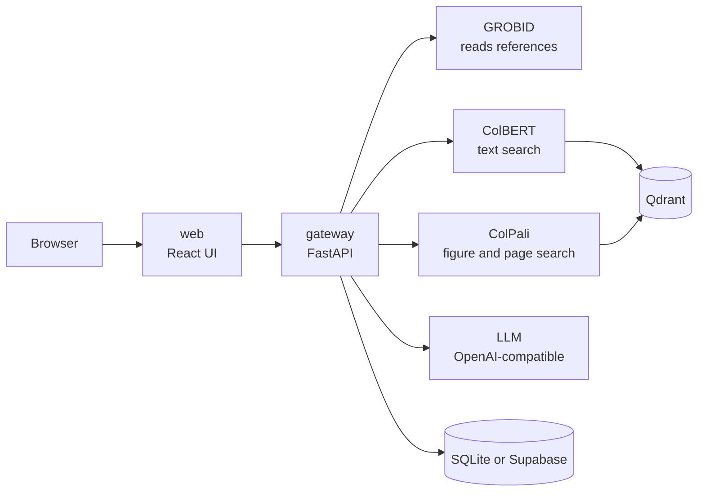
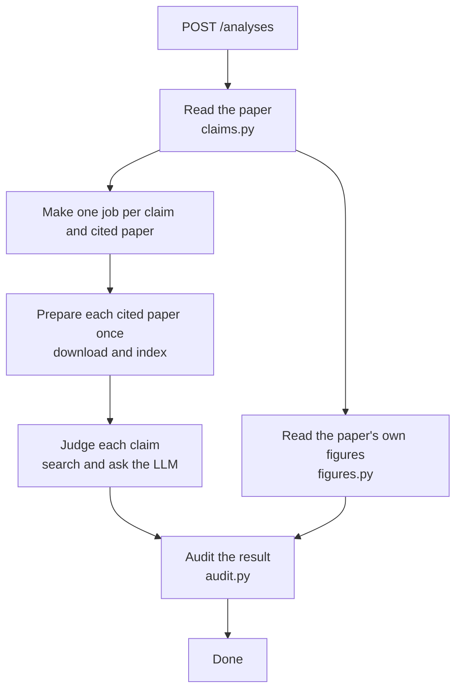
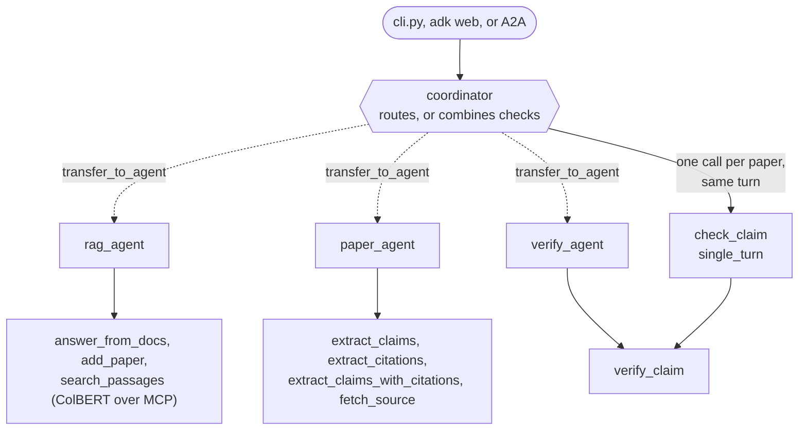
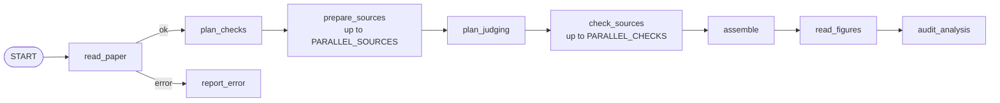
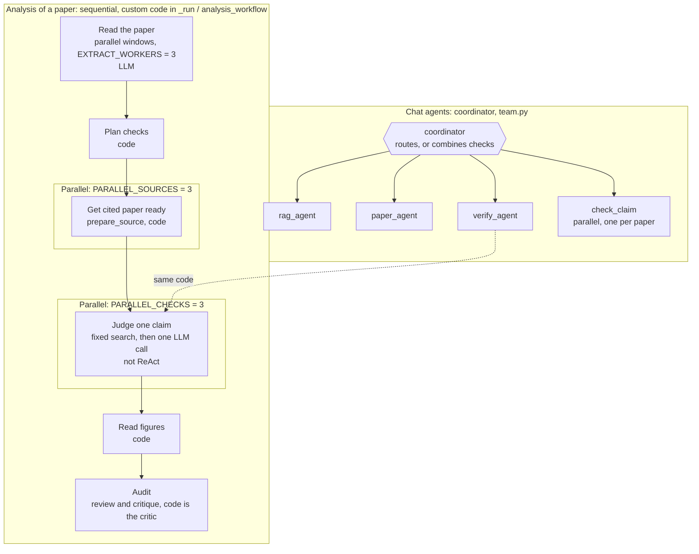

# Architecture

This page explains how SecretSource works inside: the parts, the steps of an analysis,
which design pattern each part follows and why, and which file to change for a given job.

## The parts



- `web` is the user interface. It sends every `/api` request to the gateway.
- `gateway` runs the analysis. The code is in `backend/`.
- ColBERT and ColPali are separate services in `services/`. Both store their indexes in Qdrant.
- Docling is not a service. It is a library inside the gateway that turns a PDF into text
  and cuts out figures.

## Three ways to run the pipeline

The same pipeline code (`backend/app/pipeline/`) is used in three places.

| Way | Code | Used by |
| --- | --- | --- |
| HTTP gateway | `backend/app/main.py` | the web app |
| Analysis graph | `backend/app/workflow.py` | `adk web`, for development |
| Chat agents | `backend/app/agents/team.py` | `backend/cli.py`, `adk web`, and A2A |

Only the gateway serves the web app. If you fix something for users, fix it there.
Because all three use the same pipeline functions, a fix in `backend/app/pipeline/`
reaches all three.

To open the ADK development UI: `docker compose --profile dev up -d adk-web`, then go to
http://localhost:8001.

## What happens when you analyze a paper



1. **Start.** `POST /analyses` creates an analysis with a 12-character id and returns the
   id right away. The work runs in the background. The web app follows it through
   `GET /analyses/{id}/events` (server-sent events).
2. **Read the paper.** `extract_claims_with_citations` in `claims.py` does four things.
   Docling turns the PDF into text. GROBID reads the reference list. The LLM finds the
   claims that cite other papers. `locate` finds each claim's sentence in the PDF, so the
   web app can highlight it. GROBID also gives the place of each citation marker, like
   "[13]", so the page viewer can open the reference when you click the marker.
3. **Make jobs.** Each pair of (claim, cited paper) becomes one job.
4. **Prepare each cited paper once.** `prepare_source` downloads the paper if needed. Then
   it indexes the paper in ColBERT and ColPali at the same time. Many claims can cite the
   same paper, but each paper is prepared only once. Up to `PARALLEL_SOURCES` papers
   (default 3) are prepared at the same time.
5. **Judge each claim.** When its paper is ready, `check_prepared` judges the claim. Up to
   `PARALLEL_CHECKS` claims (default 3) are judged at the same time.
6. **Read the paper's own figures.** While steps 3 to 5 run, `paper_figures` in
   `figures.py` runs Docling on the analysed paper and saves a crop of each figure. It
   keeps only figures whose caption gives their number, like "Figure 2: ...". The web app
   then turns "Figure 2" in a claim's sentence into a link to that crop. If Docling fails,
   the list is empty and the rest of the analysis is not affected.
7. **Audit.** `audit.py` checks the finished analysis for problems, for example a quote
   that is not in the evidence. It only reports problems. It never changes a verdict.

After every step the gateway calls `_publish`. This saves the analysis and sends one event
to the web app. Checks finish in any order, so every event says which claim it is about.

Reading the paper is also split into parts. Up to 3 parts (`EXTRACT_WORKERS`) go to the
LLM at the same time.

## How a claim is checked

The code is in `backend/app/pipeline/verify.py`.

**`prepare_source(source)`** gets a cited paper ready.

1. `local_pdf` finds the PDF. The source can be a local path, a DOI, an arXiv ID, a PMID, a
   URL or a title. `sources.py` looks it up and downloads it into `PAPERS_DIR`. An arXiv ID
   or a URL is used as it is. A DOI goes to Semantic Scholar, then to Unpaywall (only when
   `UNPAYWALL_EMAIL` is set). A PMID goes to Semantic Scholar. A title goes to arXiv search,
   then to Semantic Scholar search.
2. `_index_once` indexes the paper in ColBERT (text passages) and, if it is running, in
   ColPali (cropped figures, or whole pages when no figures were found). Both are done at
   the same time.

Indexing a paper first deletes its old copy. If two checks indexed the same paper at the
same time, one check could search in the middle and find nothing. So each paper has a lock,
and a paper is indexed only once per process.

**`check_prepared(claim, source, path)`** judges the claim.

1. It searches ColBERT for passages about the claim, and ColPali for matching figures or
   pages. Both searches run at the same time.
2. Figure captions are added to the evidence, because the judge can read and quote them.
3. The DSPy judge returns `supports`, `refutes` or `insufficient`, the quote it used, and
   one sentence of reasoning.

**`verify_claim(claim, source)`** calls `prepare_source` and then `check_prepared`. The chat
agents and `POST /verify` use it.

When a check fails, the result has `status: "error"` and a `reason`, for example
`no-open-access`. The web app shows the reason. A claim we could not check must not look
like a claim nobody tried.

**Papers outside a public index.** The papers we work with (the analysed paper, the works
it cites, the library, the benchmark) should be in a public index. A paper that is not is
still analysed and still gets a verdict. The web app marks it, so a reader can see that the
verdict rests on a source outside the index. We record which index answered instead of
guessing: each verdict has `indexed_in` with the index that found the paper
(`semantic-scholar`, `arxiv`, `unpaywall`, or empty) and the ids it gave. We never say
Scopus, because Semantic Scholar and arXiv cannot tell us whether a paper is in Scopus.
Only an Elsevier key could.

The knowledge graph (`researcher.graph`) turns this into `indexed` on each cited work:
`yes` when a verdict names an index or the lookup found the work without a free copy, `no`
when no index knew it (`unresolvable`, a web page, or a bare link), and empty when the run
does not say (a download that failed, or the analysed papers themselves). A work cited
several times keeps its strongest answer. The graph draws `no` as a dashed amber ring.
"Not found" means our lookup found nothing for the reference as written, so a reference
GROBID read badly can be marked too. The Library rows are not marked yet (#21): nothing
records whether the analysed paper itself is indexed.

## How DSPy is used

DSPy is a Python library for calling an LLM from code.

Without DSPy, you write a prompt as a string, send it, and then parse the text that comes
back. With DSPy, you describe the task as a **Signature**: input fields, output fields, and
a short instruction. DSPy writes the prompt, calls the LLM, and gives you back the output
fields. You read them like normal Python values, for example `prediction.verdict`.

**ADK and DSPy do different jobs.**

- Google ADK runs the agents and the order of steps (`team.py`, `workflow.py`).
- DSPy is used inside a step, for one LLM call that must return exact data.
- Both use the same LLM. `backend/app/llm.py` creates `adk_model()` for ADK and `dspy_lm()`
  for DSPy, both pointed at `VLLM_URL`.

**Our four DSPy programs**

| Signature | File | Gets | Returns | Used by |
| --- | --- | --- | --- | --- |
| `ExtractCitedClaims` | `claims.py` | part of a paper, with markers like `[b12]` | claims, each with its markers and its exact sentence | every analysis |
| `ExtractClaims` | `claims.py` | part of a paper | 3 to 6 short claims | the `extract_claims` agent tool |
| `JudgeClaim` | `verify.py` | a claim and passages from the cited paper | verdict, quote, reasoning | every check, and `POST /verify` |
| `GenerateAnswer` | `rag.py` | a question and passages | a short answer | the `answer_from_docs` agent tool |

All four use `dspy.ChainOfThought`. It asks the LLM to think step by step before it gives
the answer.

**Why we use DSPy**

- **We need exact values, not free text.** A verdict must be one of three words. A sentence
  must match the PDF word for word, so we can find and highlight it. DSPy returns these as
  fields, so we do not write fragile code to parse the reply.
- **The LLM can change without rewriting prompts.** Change `VLLM_URL` and `VLLM_MODEL`, and
  the same programs work with another OpenAI-compatible model.
- **Each LLM step is small and has a name.** It is easy to find, test and improve.
- **Later, DSPy can improve the prompts for us.** DSPy has optimizers that learn from
  labelled examples, such as our benchmark dataset. We do not use this yet.

**Settings in our code**

- The claim extractors and the judge use `dspy.JSONAdapter()`, so the LLM must answer in
  JSON. Without it, the LLM split the claim list over several lines and only one claim was
  read.
- The judge uses `temperature=0.0`, so the same input gives the same verdict as much as
  possible. If the LLM returns a word that is not one of the three verdicts, we use
  `insufficient`.
- We call `dspy.context(...)` around each LLM call, not `dspy.configure(...)`. The pipeline
  judges several claims in parallel threads, and only `dspy.context` is safe for that.
- `dspy_lm()` sends `enable_thinking: false`. A Qwen3 model that "thinks" can use all its
  tokens for thinking and return an empty answer.

**Be careful:** the Signature's docstring and the `desc` text of each field are the
instructions the LLM reads. If you edit them, the verdicts can change. Change them on
purpose, then check the results again on a paper you know.

## Google ADK: chat agents and the analysis graph

### Chat agents

`backend/app/agents/team.py`. One coordinator, three specialists, and `check_claim`, a
single-turn copy of `verify_agent` that the coordinator calls as a tool.



- A request one specialist owns is handed over whole with `transfer_to_agent`. The
  specialist then answers the user.
- A claim to check against two or more papers is not handed over. The coordinator calls
  `check_claim` once per paper in the same turn, ADK runs the calls at the same time, and
  the coordinator writes one answer: a line per paper and one sentence on whether they
  agree.
- `check_claim` has `mode="single_turn"`, which ADK recommends over wrapping an agent in
  `AgentTool`. An agent has one mode, so the tool and the transfer target are two agents
  with the same instruction.
- Each specialist has its own instruction and tools. The tools are the same pipeline
  functions the gateway uses, wrapped by `off_the_loop` so they run in a worker thread. ADK
  calls a plain function tool on its event loop, so without it parallel calls would take
  turns.

### Analysis graph

`backend/app/workflow.py`. The same steps as the gateway, written as an ADK `Workflow`
graph, so `adk web` can draw it and show the events of a run.



- We keep the graph and the gateway's `_run` in step. Both use the same pipeline
  functions, `fold_check` to add a result to its claim, `paper_figures` and `audit`. If
  you change the steps in one, change the other. The graph reads the figures after the
  checks; the gateway reads them while it checks.
- The gateway does not run through the graph, because it sends an event to the web app
  after every check.
- A run ends with `status` `ok` and the same fields the gateway stores (`paper`, `file`,
  `claims`, `figures`, `audit`), or with `status` `error` and a `message`.
- The nodes are plain Python functions, not agents.
- `prepare_sources` and `check_sources` are parallel workers: they run once for each item
  in a list, several at a time.
- Nodes share data through session state: `paper`, `file`, `claims` and `jobs`.
- Set the session state key `verify` to `false` to stop after reading the paper.

### ADK features we use

| Feature | Where |
| --- | --- |
| A coordinator that routes to sub-agents | `team.py` |
| A single-turn sub-agent called as a tool, several at once | `team.py`: `check_claim` |
| Shared session state | `workflow.py` |
| MCP tools | `team.py`: ColBERT's `search_passages` over MCP |
| Parallel workers in a graph | `workflow.py`: `prepare_sources`, `check_sources` |
| A2A server | `backend/a2a_server.py` |

We do not use `AgentTool` (`mode="single_turn"` does the same job), `LoopAgent`,
`SequentialAgent` or `ParallelAgent`. The analysis
pipeline is a graph of plain functions. The LLM is used inside two steps, reading the paper
and judging a claim, and never to choose the next step. The next section explains why.

## Design pattern

Google Cloud's guide
[Choose a design pattern for your agentic AI system](https://docs.cloud.google.com/architecture/choose-design-pattern-agentic-ai-system)
lists patterns for systems built on AI models. We compared SecretSource with it. One rule
decided most choices: the model is used only for steps that read language (reading the
paper, judging a claim), and plain code decides the order of the steps.



### What we chose

| Part | Code | Pattern | Why |
| --- | --- | --- | --- |
| Analysis of a paper | `_run` in `main.py`, `analysis_workflow` in `workflow.py` | Sequential | Every paper goes through the same steps in the same order. Nothing is decided while it runs. |
| Getting cited papers ready, judging claims | `prepare_source`, `check_prepared` in `verify.py` | Parallel | Independent jobs. Running 3 at a time cut a run from 376 s to 246 s (commit `1b10b3a`). |
| Reading the paper | `extract_claims_with_citations` in `claims.py` | Parallel | Parts of up to 12,000 characters. Up to 3 parts (`EXTRACT_WORKERS`) go to the model at once. |
| Judging one claim | `JudgeClaim` in `verify.py` | One model call, not an agent | Code runs the searches first. The model only reads the passages and picks one of three verdicts. |
| Checking the finished analysis | `audit` in `audit.py` | Review and critique, with code as the critic | The judge's quote must be in the evidence. Code can check that without a model. |
| Chat agents | `root_agent` in `team.py` | Coordinator | A chat message can ask for many things, so a model has to pick the specialist. |
| One claim against several papers, in chat | `check_claim` in `team.py` | Parallel, gathered by the coordinator | The checks do not depend on each other. The coordinator gets every verdict back and writes one answer. |

- The gateway runs the steps with plain `asyncio` in `_run`, not the ADK graph, because it
  sends an event to the web app after every check. The guide calls this the custom logic
  pattern.
- Verdicts are not merged. `fold_check` keeps each one, and the web app shows both when two
  cited papers disagree.
- The audit only reports findings. It never changes a verdict or asks the judge again, so it
  is not a loop.
- The critic is not a model, because a model costs one more call per check and can make the
  same mistake as the judge.

### Patterns we did not use

| Pattern | Why not |
| --- | --- |
| Single agent for the whole analysis | A paper has up to 20 claims (`CLAIM_LIMIT`). One agent could skip a claim or a source, and nobody would see it. |
| Hierarchical task decomposition, swarm | The guide suggests them for open problems, and they cost the most. Our task is not open: the paper gives the claims and sources. |
| Coordinator for the analysis | There is nothing to route. Every paper takes the same path. |
| Loop, iterative refinement | See the audit above. A loop costs a model call per round and needs a stop rule. |
| ReAct | The search is the same for every claim, so code runs it, and the judge is one model call. |
| Human in the loop | A run does not stop. Each verdict shows its quote, passages, and reasoning, so the reader decides after. |

## Services

| Service | What it does | Where it runs |
| --- | --- | --- |
| `colbert` | text index and search; also MCP at `/mcp/` | `services/colbert`; local GPU or Cloud Run |
| `colpali` | index and search over figures and pages | `services/colpali`; local GPU or Cloud Run |
| `grobid` | reads references and full text from PDFs | compose container (port 8070) or Cloud Run |
| `qdrant` | stores the ColBERT and ColPali indexes | compose container, or a VM in the cloud |
| LLM | extracts claims and judges them | any OpenAI-compatible endpoint (`VLLM_URL`) |
| `gateway` | the HTTP API | `backend/`, port 8080 |
| `web` | the user interface (nginx) | `frontend/`, port 5173 |
| `a2a` | the chat agents over A2A | `backend/a2a_server.py`, port 8002, `--profile a2a` |

- Every setting is an environment variable, read in `backend/app/config.py`. Change `.env`
  to point at local containers or cloud services. No code change is needed.
- `web` and `gateway` are built images. After a code change, run
  `docker compose up -d --build <service>`.

## MCP and A2A

There are two ways for other programs to use SecretSource.

- **MCP** gives access to single tools. ColBERT and ColPali serve MCP at `/mcp/`. A client
  calls a tool such as `search_passages` and gets the result. Keep the trailing slash:
  `/mcp` without it redirects and fails.
- **A2A** gives access to the whole agent team. A client sends a task in normal language,
  and the coordinator picks the specialist.

```sh
docker compose --profile a2a up -d a2a
curl http://localhost:8002/.well-known/agent-card.json

curl -X POST http://localhost:8002/ -H 'Content-Type: application/json' -d '{
  "jsonrpc": "2.0", "id": "1", "method": "message/send",
  "params": {"message": {"messageId": "1", "role": "user",
    "parts": [{"kind": "text", "text": "List the claims in data/papers/paper.pdf"}]}}}'
```

`A2A_HOST` and `A2A_PORT` set the address written in the agent card. Callers must be able to
reach it: `a2a:8002` from another compose service, `localhost:8002` from your machine.

## Where data is stored

- While an analysis runs, it lives in memory in `main.py` (`analyses`, and one event queue
  per analysis in `streams`).
- Every `_publish` also saves the whole analysis through `backend/app/store.py`. So history
  survives a restart. On startup, analyses that were still running are marked as
  interrupted.
- The store is SQLite by default. If `SUPABASE_URL` and `SUPABASE_SERVICE_ROLE_KEY` are set,
  it uses Supabase Postgres. The service role key must stay on the server.
- The store also caches resolved sources, so running the same paper again does not repeat
  the lookups.
- Downloaded PDFs and figure crops are files in `data/papers/`.
- Chat agent sessions (`backend/cli.py`, the A2A server) live in memory by default. If
  `SESSION_DB_URL` is set to a Postgres URL, `backend/app/sessions.py` keeps them in
  Postgres with ADK's `DatabaseSessionService`, so a session continues after a restart
  (`python cli.py --session <id>`). ADK's tables go in the `adk` schema, not `public`,
  because Supabase serves `public` through its REST API to the browser's anon key.
- Each analysis has an `owner`: the Supabase user who started it, or empty when login is off.
  `backend/app/auth.py` checks the user's access token. A user only sees, opens and deletes
  their own analyses.
- Researcher projects (a name and a list of analysis ids) are in the `projects` table of the
  same store, with an owner. Everything else on the researcher screens is computed from the
  user's analyses when it is asked for; nothing else is stored.

## Researcher screens

The researcher role shows the user's own work. `backend/app/researcher.py` builds each screen
from the user's analyses, without new LLM calls:

| Screen | Route | Built from |
| --- | --- | --- |
| Home | `GET /researcher/home` | claim counts, claims a cited work contradicts, and works cited more than once that are not analysed yet (the reading queue) |
| Library | `GET /researcher/projects`, `GET /researcher/projects/{id}/library` | the user's projects; `unsorted` holds analysed papers in no project |
| Field consensus | `POST /researcher/consensus` | claims whose words match the question, with the verdicts and quotes already found |
| Graph | `GET /researcher/graph` | papers, claims, and which cited works back or contradict each claim |

`POST /researcher/projects` creates a project, and `POST /researcher/projects/{id}/papers`
adds an analysis to it.

## Where to change what

| I want to change... | File |
| --- | --- |
| anything the web app does | `backend/app/main.py`, `frontend/src` |
| how claims are found, or how a sentence is found in the PDF | `backend/app/pipeline/claims.py` |
| how a citation becomes a downloaded PDF | `backend/app/pipeline/sources.py` |
| what counts as evidence, or how a verdict is decided | `backend/app/pipeline/verify.py` |
| figure extraction | `backend/app/pipeline/figures.py` |
| search behaviour (chunks, batches, collections) | `services/colbert`, `services/colpali` |
| which LLM is used, or how it is called | `backend/app/llm.py`, `backend/app/config.py` |
| how much runs at the same time | `PARALLEL_SOURCES`, `PARALLEL_CHECKS` in `.env` |
| the graph in `adk web` | `backend/app/workflow.py` |
| the chat agents and their routing | `backend/app/agents/team.py` |
| the researcher Home, Library, Field consensus or Graph | `backend/app/researcher.py`, `frontend/src/roles/researcher` |
