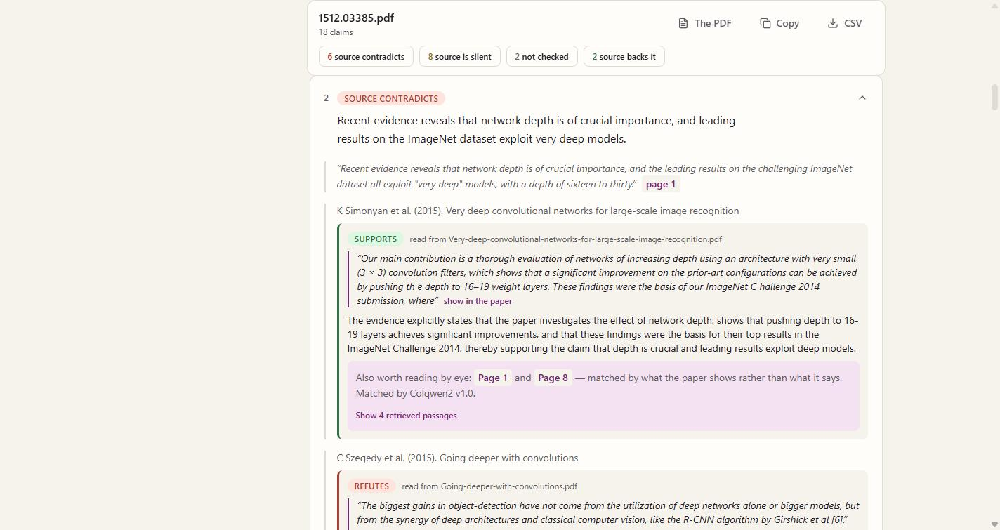
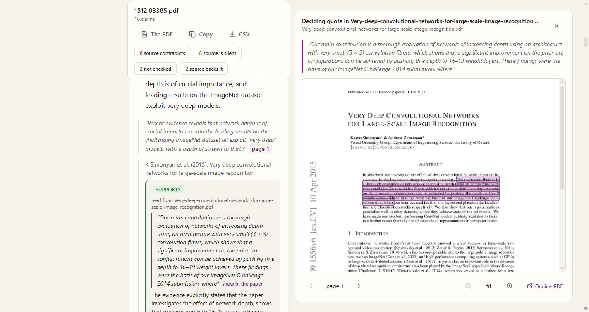
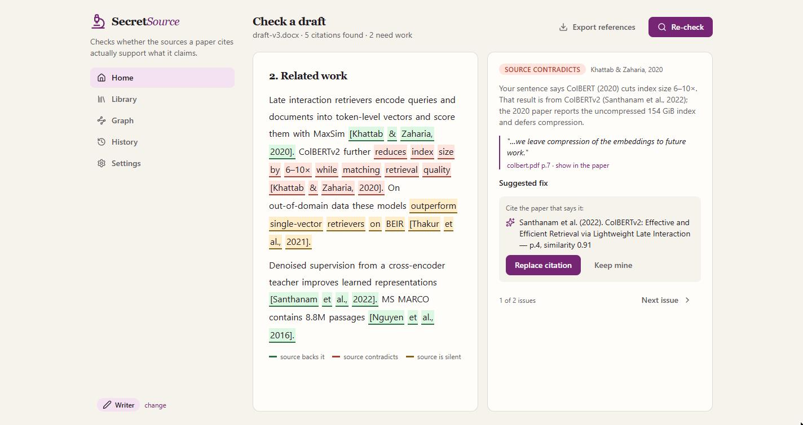

<div align="center">
  
  <br /><br />
  <p>Checks if the papers a research paper cites really say what it claims. Every result shows the quote and where it is in the PDF.</p>
  <h4><a href="#quick-start">Quick start</a> · <a href="#troubleshooting">Troubleshooting</a> · <a href="ARCHITECTURE.md">Architecture</a> · <a href="https://github.com/ZenithGeeks/SecretSource-prototype/issues">Report a bug</a></h4>
</div>
<br />

## Contents

- [What it is](#what-it-is)
- [Screenshots](#screenshots)
- [Quick start](#quick-start)
- [Run the retrieval services on your own GPU](#run-the-retrieval-services-on-your-own-gpu)
- [Everyday use](#everyday-use)
- [Troubleshooting](#troubleshooting)
- [API](#api)
- [Roadmap](#roadmap)
- [For maintainers](#for-maintainers)
- [Team](#team)
- [Acknowledgements](#acknowledgements)

## What it is

SecretSource reads a research paper, finds its claims, and checks each claim against the
paper it cites. For each claim you get a verdict (`supports`, `refutes` or `insufficient`),
the quote from the cited paper, and the page where the quote is.

Google ADK runs the agents and the order of the steps. DSPy is used for each LLM call that
must return exact data, like the claims and the verdicts. See
[How DSPy is used](ARCHITECTURE.md#how-dspy-is-used).

On your machine, Docker runs two things: `web` (the UI at http://localhost:5173) and
`gateway` (the API at http://localhost:8080). The heavy services are shared and already
run in the cloud:

| Service | What it does | Where |
| --- | --- | --- |
| ColBERT (`colbert`) | finds text passages in the cited papers | shared cloud service |
| ColPali (`colpali`) | finds matching figures and pages | shared cloud service (GPU; first request after idle takes about a minute) |
| GROBID (`grobid`) | reads a PDF's reference list and full text | shared cloud service |
| Qdrant | stores the ColBERT and ColPali indexes | shared cloud; only ColBERT and ColPali talk to it, so you never configure it |
| LLM | extracts claims and writes verdicts (any OpenAI-compatible endpoint) | shared endpoint |

The cloud services only accept requests with a Google identity token. The gateway adds the
token for you after you do steps 3 and 4 below.

## Screenshots

Analysis results. For each claim: the verdict, the quote from the cited paper, and pages
that ColPali found:



The quote highlighted in the cited PDF:



<details>
<summary>More screens</summary>

Choosing a role:


Researcher home:


Writer draft check (sample data):


</details>

## Quick start

1. **Prerequisites:** Git and Docker Desktop (Docker with Compose). No GPU, no Python, no Node.

2. **Clone and copy the env file:**

   ```sh
   git clone https://github.com/ZenithGeeks/SecretSource-prototype.git
   cd SecretSource-prototype
   cp .env.example .env
   ```

3. **Fill in `.env`**. Everything else in `.env.example` can stay empty:

   | Variable | Value | Where it comes from |
   | --- | --- | --- |
   | `VLLM_URL` | shared LLM endpoint, ends in `/v1` | `<from the team lead>` |
   | `VLLM_MODEL` | model id the endpoint lists | `<from the team lead>` |
   | `VLLM_API_KEY` | key for that endpoint | `<from the team lead>` |
   | `COLBERT_URL` | shared ColBERT URL | `<from the team lead>` |
   | `COLPALI_URL` | shared ColPali URL | `<from the team lead>` |
   | `GROBID_URL` | shared GROBID URL | `<from the team lead>` |
   | `SERVICE_AUTH` | `google-id-token` | type it |
   | `GOOGLE_APPLICATION_CREDENTIALS` | `secrets/service-auth.json` | type it (the file itself comes from the team lead) |
   | `S2_API_KEY` | your own free Semantic Scholar key | https://www.semanticscholar.org/product/api (strongly recommended: without it most cited papers never resolve) |

   Optional settings:
   - `UNPAYWALL_EMAIL`: your email. It helps find free PDFs.
   - `CLAIM_LIMIT`: the most claims to check per paper. Default `20`. `0` means all.
   - `PARALLEL_SOURCES`: how many cited papers are prepared at the same time. Default `3`.
   - `PARALLEL_CHECKS`: how many claims are judged at the same time. Default `3`.
   - `PARALLEL_SOURCES_TOTAL`, `PARALLEL_CHECKS_TOTAL`: the same two limits across every analysis
     running at once. Default: the per-run values.

4. **Add the credentials file:** save the file from the team lead as
   `backend/secrets/service-auth.json`. Git ignores this folder, and Docker never copies it
   into an image.

5. **Start the stack:**

   ```sh
   docker compose up -d --build
   ```

   This also starts a local `grobid` container. It is not used when `GROBID_URL` points to
   the cloud one.

6. **Open the app:** go to http://localhost:5173 and paste an arXiv ID (for example `2112.01488`) or upload a PDF. Check the API is up with:

   ```sh
   curl http://localhost:8080/health
   ```

## Run the retrieval services on your own GPU

Use this when the cloud services are not available. ColBERT and ColPali run on your own
NVIDIA GPU. A 16 GB card is enough. The LLM is still the shared endpoint.

1. In `.env`, leave `COLBERT_URL`, `COLPALI_URL`, `GROBID_URL`, `QDRANT_URL` and `QDRANT_API_KEY` empty. Set `SERVICE_AUTH=none`. Keep the `VLLM_*` values for the shared LLM endpoint.

2. Start the services:

   ```sh
   docker compose up -d --build qdrant grobid colbert colpali gateway web
   ```

3. The models are ColBERTv2 (`colbert-ir/colbertv2.0`, about 0.5 GB) and ColPali (`COLPALI_MODEL=vidore/colqwen2-v1.0`, about 4 GB). In a test run, both together used about 7 to 9 GB of GPU memory.

4. The first start downloads the models, so it takes several minutes. Check that the services are up:

   ```sh
   curl http://localhost:8893/health
   curl http://localhost:8894/health
   ```

No LLM endpoint? `docker compose --profile gpu up -d --build` also runs vLLM on your GPU.

## Everyday use

- Stop the stack: `docker compose down`
- After `git pull`, rebuild: `docker compose up -d --build`
- After you edit `.env`, run `docker compose up -d`. Containers read `.env` only when they start
- Logs: `docker compose logs -f gateway`

In the web app, paste an arXiv ID, a DOI or a URL, or upload a PDF. You can watch each step
while it runs. Past analyses are in History.

## Troubleshooting

| Symptom | Fix |
| --- | --- |
| 401 or 403 from colbert, colpali or grobid in the gateway logs | check `SERVICE_AUTH=google-id-token`, `GOOGLE_APPLICATION_CREDENTIALS=secrets/service-auth.json`, and that `backend/secrets/service-auth.json` exists; then `docker compose up -d` |
| Gateway exits with "SERVICE_AUTH must be 'none' or 'google-id-token'" | typo in `SERVICE_AUTH` |
| 503 from the cloud services | the services sleep when nobody uses them. The first request wakes them (ColBERT: a few seconds, ColPali: about a minute). If it does not stop, tell the team lead |
| "The LM returned an empty or null response." | check `VLLM_URL` ends in `/v1` and `VLLM_MODEL` is an id the endpoint lists |
| Most citations show as unresolved / Semantic Scholar 429 | set `S2_API_KEY` |
| No figure or page hints | ColPali is still starting. The check still works, just without figure hints |
| Port 5173 or 8080 already in use | another copy is running. Run `docker compose down` in that folder first |

## API

Interactive docs: http://localhost:8080/docs. The short version:

```
POST /analyses             start an analysis {"paper": "path | DOI | arXiv | URL"}
POST /analyses/upload      upload a PDF
GET  /analyses/{id}/events  SSE progress, one event per pipeline stage
GET  /papers/{name}/find   where a sentence sits in the PDF
POST /verify               one claim against one source
GET  /health
```

## Roadmap

- [ ] One MCP server for SecretSource with API-key access, for editors and other agents (SCRUM-165)
- [ ] Ready-made .env templates and a dependency report in /health (SCRUM-163)
- [ ] Papers and figures in cloud storage, so nothing lives on one machine (SCRUM-164)
- [ ] Public web, gateway and MCP entry points (SCRUM-166)
- [ ] Analyses that survive cloud restarts (SCRUM-167)

## For maintainers

The quick start is enough to use the app. The sections below are for people who change the
system.

<details>
<summary>How it works</summary>

```
frontend (React)  ──► gateway (FastAPI)
                         │
                         ├─ GROBID          reference + fulltext parsing
                         ├─ Docling         PDF → text, figure crops (a library inside the gateway)
                         ├─ vLLM            claim extraction + verdicts (any OpenAI-compatible server)
                         ├─ colbert service text retrieval  ─┐
                         └─ colpali service visual retrieval ─┴─► Qdrant (MaxSim multivectors)

paper.pdf
   └─ extract_claims_with_citations   claim + the references it cites (GROBID + LLM)
        └─ prepare_source             download the cited PDF, index it in ColBERT and ColPali
             └─ check_prepared        supports / refutes / insufficient + the quote
```

[ARCHITECTURE.md](ARCHITECTURE.md) goes a level deeper.
</details>

<details>
<summary>Repository layout</summary>

```
backend/            gateway API, pipeline, agents  (Python, FastAPI, ADK, DSPy)
  app/main.py         HTTP gateway the frontend talks to
  app/pipeline/       claims, sources, verify, figures, rag
  app/workflow.py     the pipeline as an ADK Workflow graph
  a2a_server.py       the agent tree over A2A (docker compose --profile a2a)
  cli.py              agent REPL
frontend/           React + Vite UI, served by nginx which proxies /api to the gateway
services/colbert/   ColBERTv2 text retrieval (HTTP + MCP, Qdrant)
services/colpali/   ColPali visual retrieval (HTTP + MCP, Qdrant, opt-in)
deploy/             Cloud Run deploy script, Qdrant VM startup script, vLLM-on-Cloud-Run guide
data/papers/        downloaded PDFs and figure crops (gitignored, shared volume in compose)
```
</details>

<details>
<summary>Deploying to Cloud Run</summary>

Run `PROJECT=<gcp-project> ./deploy/cloudrun.sh`. It builds every image with Cloud Build and
deploys grobid, colbert, colpali, vllm, gateway and web to Cloud Run. Set `VISION=0` to skip
colpali. Qdrant runs on a small VM with its own disk (`deploy/qdrant-startup.sh`). To use a
Qdrant cluster instead, set `QDRANT_URL` and `QDRANT_API_KEY`. For the vLLM part (quota,
start-up time, cost), read [deploy/vllm-cloud-run.md](deploy/vllm-cloud-run.md).
</details>

<details>
<summary>Dev tools: ADK web UI and A2A</summary>

```sh
docker compose --profile dev up -d adk-web       # then open http://localhost:8001
docker compose --profile a2a up -d a2a           # the agent tree over A2A at http://localhost:8002
```
</details>

<details>
<summary>Running pieces on the host</summary>

You can run each part without Docker. It uses the settings in `.env`. Use `localhost`, not
container names:

```sh
# gateway (from backend/)
cd backend && pip install -r requirements.txt
python -m uvicorn app.main:app --port 8080

# agent REPL (from the repo root)
python backend/cli.py

# retrieval service (from services/colbert/; needs Qdrant: docker compose up -d qdrant)
cd services/colbert && pip install -r requirements.txt
python server.py

# frontend dev server (from frontend/; proxies /api to :8080)
cd frontend && npm ci && npm run dev
```
</details>

<details>
<summary>Tests and CI</summary>

```sh
cd backend && pip install -r requirements-dev.txt && pytest
```

CI runs on every PR and on `main`: `ruff check backend services`, `python -m compileall -q backend/app backend/cli.py services`, `npm run lint` and `npm run build` (frontend).
</details>

<details>
<summary>Contributing</summary>

- Branch names start with the Jira key: `SCRUM-<n>-short-slug`, one branch per ticket, off `main`.
- Commit and PR titles use Conventional Commits with the Jira key as scope. For example `fix(SCRUM-142): drop the stale researcher session on refresh`.
- Open pull requests against `main`.
- One service is one folder with one Dockerfile. Services talk to each other only over HTTP or MCP.
- Tool functions return `{"status": "ok" | "error", ...}`. They do not raise errors.
</details>

<details>
<summary>Optional: Supabase persistence</summary>

Set both `SUPABASE_URL` and `SUPABASE_SERVICE_ROLE_KEY` to save analyses in Supabase Postgres
instead of local SQLite. The service role key can read and write all data, so keep it on the
server. Never put it in the frontend or in git. See [supabase/README.md](supabase/README.md).
</details>

## Team

- [EarthWittawat](https://github.com/EarthWittawat)
- [JoyChanya](https://github.com/JoyChanya)
- [ZeaNL](https://github.com/ZeaNL)
- [Richyboy170](https://github.com/Richyboy170)

Ask @EarthWittawat for the shared .env values and the credentials file.

## Acknowledgements

[ColBERT](https://github.com/stanford-futuredata/ColBERT), [ColPali](https://github.com/illuin-tech/colpali), [GROBID](https://github.com/kermitt2/grobid), [Docling](https://github.com/docling-project/docling), [DSPy](https://github.com/stanfordnlp/dspy), [Google ADK](https://github.com/google/adk-python), [Qdrant](https://github.com/qdrant/qdrant), [vLLM](https://github.com/vllm-project/vllm), [Awesome Readme Template](https://github.com/Louis3797/awesome-readme-template)

No license has been chosen yet; all rights reserved by the project team.
