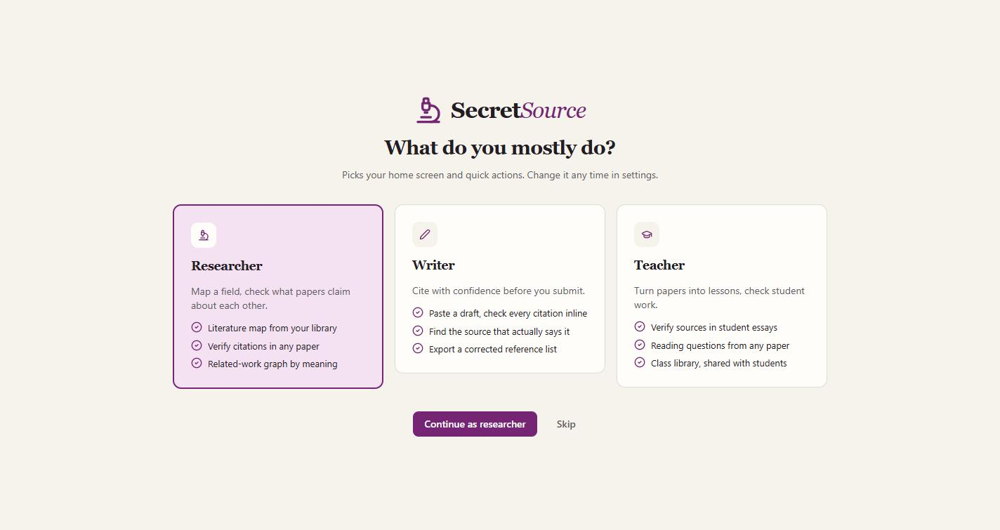
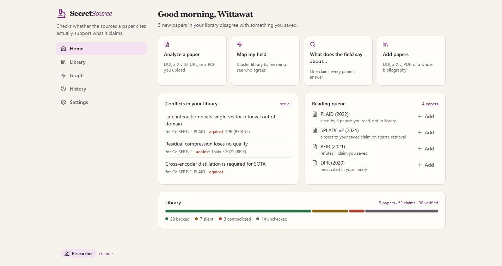

<div align="center">
  
  <br /><br />
  <p>Checks if the papers a research paper cites really say what it claims. Every result shows the quote and where it is in the PDF.</p>
  <h4><a href="#quick-start">Quick start</a> · <a href="#troubleshooting">Troubleshooting</a> · <a href="ARCHITECTURE.md">Architecture</a> · <a href="https://github.com/ZenithGeeks/SecretSource-prototype/issues">Report a bug</a></h4>
</div>
<br />

## Contents

- [What it is](#what-it-is)
- [Screenshots](#screenshots)
- [Quick start](#quick-start)
- [Everyday use](#everyday-use)
- [Troubleshooting](#troubleshooting)
- [Benchmarks & notes](#benchmarks--notes)
- [API](#api)
- [Architecture & development](#architecture--development)
- [Team](#team)
- [Acknowledgements](#acknowledgements)
- [License](#license)

## What it is

SecretSource reads a research paper, extracts its claims, and checks each claim against the paper it cites. Each claim gets a verdict (`supports`, `refutes`, or `insufficient`), the matching quote from the cited paper, and the page where the quote appears.

Google ADK orchestrates the multi-agent workflows and tool routing. DSPy handles structured LLM calls such as claim extraction and verdict generation. See [How DSPy is used](ARCHITECTURE.md#how-dspy-is-used).

The Docker Compose stack runs:

| Service | Role | Notes |
| --- | --- | --- |
| `web` | React + Vite UI (`http://localhost:5173`) | Served by nginx, proxies `/api` to `gateway` |
| `gateway` | FastAPI API & ADK runtime (`http://localhost:8080`) | Interactive docs at `/docs` |
| `worker` | Background RQ worker | Runs analyses and draft checks |
| `redis` | Job queue and progress stream | Internal |
| `grobid` | PDF reference and full-text parser | `lfoppiano/grobid:0.8.2` |
| `colbert` | Passage retrieval (`colbert-ir/colbertv2.0`) | ~0.5 GB model; writes per-paper vector files |
| `colpali` | Optional visual/figure retrieval (`vidore/colqwen2-v1.0`) | Used only when `VISUAL_EVIDENCE=true` |
| `vllm` (`--profile gpu`) | Optional local OpenAI-compatible LLM server | Or point `VLLM_URL` at any OpenAI-compatible endpoint |

## Screenshots

Analysis results with verdicts, quotes, and visual page matches:


The quote highlighted in the cited PDF:


<details>
<summary>More screens</summary>

Choosing a role:



Researcher home:



Author draft check:


</details>

## Quick start

1. **Prerequisites:** Git and Docker Desktop (Docker with Compose). An NVIDIA GPU (~16 GB VRAM) is needed if you run `vllm` / `colpali` locally; otherwise you can point `VLLM_URL` at any OpenAI-compatible API.

2. **Clone and create `.env`:**

   ```sh
   git clone https://github.com/ZenithGeeks/SecretSource-prototype.git
   cd SecretSource-prototype
   cp .env.example .env
   ```

   Or start from `.env.local-gpu` if you want to run everything (including local vLLM, ColBERT, and ColPali) on one NVIDIA GPU.

3. **Configure `.env`:**

   | Variable | Description |
   | --- | --- |
   | `VLLM_URL`, `VLLM_MODEL`, `VLLM_API_KEY` | Any OpenAI-compatible `/v1` endpoint and model ID (leave empty when using `--profile gpu`) |
   | `S2_API_KEY` | Free [Semantic Scholar API key](https://www.semanticscholar.org/product/api) — strongly recommended so cited papers resolve reliably |
   | `UNPAYWALL_EMAIL` | Optional email used when resolving open-access PDFs via Unpaywall |

   Useful defaults (optional):
   - `CLAIM_LIMIT=20` (`0` checks every extracted claim)
   - `PARALLEL_SOURCES=3`, `PARALLEL_CHECKS=3` (per-run concurrency)
   - `VISUAL_EVIDENCE=false` (set `true` to enable ColPali figure/page retrieval)
   - `SUPABASE_URL`, `SUPABASE_SERVICE_ROLE_KEY`, `VITE_SUPABASE_ANON_KEY`: optional Postgres persistence and sign-in; when unset, analyses are stored in local SQLite and the app runs without login.
   - `TEACHER_GOOGLE_ENABLED=false`: optional Google Classroom integration (see [Teacher Google Classroom setup](backend/README.md#teacher-google-classroom)).

4. **Start the stack:**

   With an external LLM endpoint (and local GROBID + ColBERT):

   ```sh
   docker compose up -d --build grobid colbert redis gateway worker web
   ```

   Or with a local GPU running vLLM and ColPali as well:

   ```sh
   docker compose --profile gpu --profile vision up -d --build
   ```

   First startup downloads the retrieval models, which takes a few minutes.

5. **Verify health:**

   ```sh
   curl http://localhost:8080/health
   ```

   `"degraded": false` means every required dependency answered. You can also check `docker compose logs gateway`.

6. **Open the app:** go to `http://localhost:5173` and paste an arXiv ID (for example `2112.01488`), a DOI/URL, or upload a PDF.

## Everyday use

- Stop the stack: `docker compose down`
- Rebuild after pulling changes: `docker compose up -d --build`
- Scale concurrent analyses: `docker compose up -d --scale worker=3` (one worker runs one analysis at a time)
- Reload `.env` changes: `docker compose up -d`
- Tail gateway logs: `docker compose logs -f gateway`
- Profile a stuck request: `docker exec <gateway-container> py-spy dump --pid 1` (see [Profiling](backend/README.md#profiling))
- Run Docling on GPU instead of CPU:
  ```sh
  docker compose -f docker-compose.yml -f docker-compose.gpu.yml up -d --build worker gateway
  ```
- Optional monitoring dashboards: `docker compose --profile monitoring up -d` (see [deploy/monitoring/README.md](deploy/monitoring/README.md))

## Troubleshooting

| Symptom | Fix |
| --- | --- |
| `/health` says `"degraded": true` | Find the entry with `"ok": false`, fix its URL or key in `.env`, then run `docker compose up -d` |
| 401 or 403 from `colbert`, `colpali`, or `grobid` | Check `SERVICE_AUTH` (`none` for local containers, `google-id-token` with `backend/secrets/service-auth.json` for Cloud Run) |
| Gateway exits with `"SERVICE_AUTH must be 'none' or 'google-id-token'"` | Fix the typo in `SERVICE_AUTH` in `.env` |
| `"The LM returned an empty or null response."` | Check that `VLLM_URL` ends with `/v1` and `VLLM_MODEL` matches a model served by the endpoint |
| Most citations show as unresolved / Semantic Scholar 429 | Set `S2_API_KEY` in `.env` |
| No figure or page hints | ColPali runs only when `VISUAL_EVIDENCE=true` and `colpali` is running |
| Port `5173` or `8080` already in use | Stop the other compose stack with `docker compose down` |
| An analysis stays `queued` and never moves | Check `worker` in `/health` and start it with `docker compose up -d worker` |
| `503` when starting an analysis | Redis is unreachable; check `REDIS_URL` and the `redis` container |

## Benchmarks & notes

Measured on a self-hosted setup (one mini PC for `web`/`gateway`/`redis` and one RTX 5070 Ti host for `grobid`/`colbert`/`colpali`/`worker`):

- An uncached analysis of arXiv `2305.06500` takes about **84 s** (claims extracted at 37 s; 11 checks finish between 48 s and 84 s).
- ColBERT indexes figure captions with page text. On 191 finished claim/source pairs (three runs each):
  - Two runs with ColPali off: 12–14 verdict differences (7–9 on figure-caption pairs)
  - Two runs with ColPali on: 8–16 verdict differences (5–8 on figure-caption pairs)
  - One run off, one run on: 13–20 verdict differences (4–11 on figure-caption pairs)
- Running multiple Docling parses in parallel (`DOCLING_PARALLEL > 1`) slowed 10 cited PDFs on 4 CPUs from 377 s (`1`) to 490 s (`2`) and 421 s (`3`) because a single Docling run already saturates available CPU cores.

## API

Interactive OpenAPI docs are at `http://localhost:8080/docs`. Core endpoints:

```text
POST /analyses              start an analysis {"paper": "path | DOI | arXiv | URL"}
POST /analyses/upload       upload a PDF
GET  /analyses/{id}/events  SSE progress stream
GET  /papers/{name}/find    locate a sentence inside a PDF
POST /verify                check one claim against one source
GET  /health                dependency health status
```

## Architecture & development

<details>
<summary>How it works</summary>

```text
frontend (React)  ──► gateway (FastAPI)  ──► Redis queue  ──► worker

worker (one analysis at a time)
   ├─ GROBID          reference + fulltext parsing
   ├─ Docling         PDF → text, figure crops (in-process)
   ├─ vLLM            claim extraction + verdicts (OpenAI-compatible endpoint)
   ├─ colbert service text retrieval  ─┐
   └─ colpali service visual retrieval ─┴─► per-paper vector files (local volume or GCS)

paper.pdf
   └─ extract_claims_with_citations   claim + cited references (GROBID + LLM)
        └─ prepare_source             download cited PDF, index in ColBERT / ColPali
             └─ check_prepared        supports / refutes / insufficient + quote
```

See [ARCHITECTURE.md](ARCHITECTURE.md) for details.
</details>

<details>
<summary>Repository layout</summary>

```text
backend/            gateway API, pipeline, ADK agents (Python, FastAPI, ADK, DSPy)
  app/main.py         HTTP gateway
  app/pipeline/       claims, sources, verify, figures, rag
  app/agents/         screen agents, data tools, team workflow
  app/teacher/        Google Classroom sync and essay-check review
  a2a_server.py       agent tree over A2A (docker compose --profile a2a)
  cli.py              agent CLI REPL
  worker.py           RQ worker for analyses and draft checks
frontend/           React + Vite UI (nginx proxies /api to gateway)
services/colbert/   ColBERTv2 text retrieval service
services/colpali/   ColPali visual retrieval service
deploy/             Cloud Run, GPU compose, and monitoring configs
supabase/           Optional Supabase Postgres migrations
data/papers/        downloaded PDFs and figure crops (gitignored)
```
</details>

<details>
<summary>Running pieces on the host</summary>

Backend services read `.env` from the repository root (use `localhost` instead of container names). Vite reads only `frontend/.env` (`frontend/.env.example`).

```sh
# gateway
cd backend && pip install -r requirements.txt
python -m uvicorn app.main:app --port 8080

# agent CLI REPL (from repo root)
python backend/cli.py

# ColBERT retrieval service
cd services/colbert && pip install -r requirements.txt
python server.py

# frontend dev server (proxies /api to :8080)
cd frontend && npm ci && npm run dev
```
</details>

<details>
<summary>Dev tools: ADK web UI and A2A</summary>

```sh
docker compose --profile dev up -d adk-web       # http://localhost:8001
docker compose --profile a2a up -d a2a           # http://localhost:8002
```
</details>

<details>
<summary>Tests and CI</summary>

```sh
ruff check backend services
python -m compileall -q backend/app backend/cli.py services
cd backend && pip install -r requirements-dev.txt && pytest
cd ../frontend && npm run lint && npm run build && npm test
```
</details>

<details>
<summary>Optional: Supabase persistence & Cloud Run deployment</summary>

- **Supabase**: Set `SUPABASE_URL` and `SUPABASE_SERVICE_ROLE_KEY` in `.env` (and `VITE_SUPABASE_URL` / `VITE_SUPABASE_ANON_KEY` for login). See [supabase/README.md](supabase/README.md).
- **Cloud Run**: `PROJECT=<gcp-project> ./deploy/cloudrun.sh` builds and deploys the services to Google Cloud Run (set `VISION=0` to skip `colpali`). See [deploy/vllm-cloud-run.md](deploy/vllm-cloud-run.md) and [ARCHITECTURE.md](ARCHITECTURE.md#services).
</details>

<details>
<summary>Contributing</summary>

- Branch from `main` and open pull requests against `main`.
- Keep services isolated: one service per folder with its own `Dockerfile`, communicating over HTTP or MCP.
- Tool functions return `{"status": "ok" | "error", ...}` instead of raising uncaught errors.
- Run backend (`ruff`, `pytest`) and frontend (`npm run lint`, `npm run build`, `npm test`) checks before opening a PR.
</details>

## Team

- [EarthWittawat](https://github.com/EarthWittawat)
- [JoyChanya](https://github.com/JoyChanya)
- [ZeaNL](https://github.com/ZeaNL)
- [Richyboy170](https://github.com/Richyboy170)

## Acknowledgements

[ColBERT](https://github.com/stanford-futuredata/ColBERT), [ColPali](https://github.com/illuin-tech/colpali), [GROBID](https://github.com/kermitt2/grobid), [Docling](https://github.com/docling-project/docling), [DSPy](https://github.com/stanfordnlp/dspy), [Google ADK](https://github.com/google/adk-python), [safetensors](https://github.com/huggingface/safetensors), [vLLM](https://github.com/vllm-project/vllm), [Awesome Readme Template](https://github.com/Louis3797/awesome-readme-template)

## License

Licensed under the [MIT License](LICENSE).
