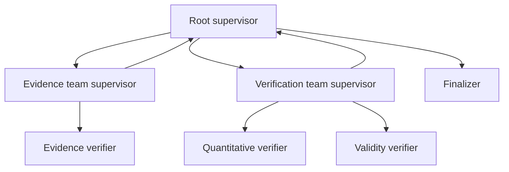

# SecretSource Agent Architecture Lab

This is an isolated research harness for comparing multi-agent architectures
that may later verify scientific-paper claims. It lives under
`SecretSource-prototype/agent-arch/` so experiments do not change the shared
SecretSource backend, frontend, services, deployment files, or root project
configuration.

The architecture is the independent variable. Every offline run uses the same
`Task`, deterministic mock-agent behavior, result schema, and provider. Model,
prompts, tools, datasets, and retrieved evidence can be controlled later when
real verification agents are connected.

## What is implemented

| ID | Architecture | Information flow | Framework |
| --- | --- | --- | --- |
| A1 | Magentic team lead + agent team | Open worker result visibility | Offline coordinator; official Microsoft runner is opt-in |
| A2 | Hierarchical multi-agent | Root → sub-team → worker | LangGraph `StateGraph` and compiled subgraphs |
| A3 | Agent team + blackboard | Structured shared evidence state | Plain Python |
| A4 | Magentic + context isolation | Manager sees results; peers do not | Offline isolation coordinator |

Each architecture is in a separate folder under
`src/agent_arch_experiments/architectures/`, has its own README and runnable
entry point, and does not import implementation code from another architecture.
The evaluation runner imports them by name so removing unused architecture
folders does not affect the remaining direct runners.

## Shared agent boundary

The only agent construction point is
`src/agent_arch_experiments/agents/provider.py`:

```text
architecture folders → agents/provider.py → deterministic MockAgent objects
```

The common interface is an async call receiving `Task` and `AgentContext` and
returning `AgentResult`. Context-visible peer results are explicit data, which
makes A1/A4’s information-flow difference testable. This is application-visible
context only; the harness makes no claim to isolate hidden chain-of-thought.

## A1 — Magentic Team

The offline coordinator follows the official Magentic concept of a manager that
plans, dynamically selects participants, observes progress, and synthesizes a
final answer. A1 passes prior worker results into later worker contexts.

`OfficialMagenticRunner` uses the current Microsoft Agent Framework
`MagenticBuilder` when supplied with official framework participant objects.
That path is model-backed and requires the optional dependency and credentials;
it is intentionally separate from the offline test coordinator.
The adapter uses the currently installed builder's
`intermediate_output_from="all_other"` option; older examples may show an
`intermediate_outputs=True` option that is not accepted by the verified current
API.

See `src/agent_arch_experiments/architectures/magentic_team/README.md`.

## A2 — Hierarchical LangGraph

A real LangGraph parent graph routes to two compiled subgraphs:



The implementation uses typed states, explicit nodes, conditional edges, and
compiled subgraphs. `hierarchical_mermaid()` provides the stable diagram used
in result metadata and documentation.

See `src/agent_arch_experiments/architectures/hierarchical_langgraph/README.md`.

## A3 — Blackboard

The blackboard is a structured state object, not a list of messages. It stores
the task, evidence, typed findings, contradictions, per-agent confidence,
provenance, versioned events, and snapshots. Independent workers read the board
and publish to it; a synthesizer reads the resulting board.

See `src/agent_arch_experiments/architectures/blackboard_team/README.md`.

## A4 — Context Isolation

A4 keeps the same three worker roles and manager loop shape as A1. Its
`ContextPolicy` creates a fresh worker packet containing only the task,
allow-listed global metadata, objective, and permitted source evidence. Peer
results and peer message histories are excluded. The manager receives all
worker results for synthesis.

The current official Microsoft Magentic builder does not document a per-worker
application-context interception hook. Therefore A4’s isolation coordinator is
custom and labeled as such; using the official builder without that boundary
would not prove isolation.

See `src/agent_arch_experiments/architectures/magentic_context_isolation/README.md`.

## Installation

From this directory:

```text
py -m pip install -e ".[dev]"
```

That installs the offline harness and development tools. To run the real
LangGraph architecture too:

```text
py -m pip install -e ".[dev,langgraph]"
```

To enable the opt-in Microsoft runner dependencies:

```text
py -m pip install -e ".[dev,langgraph,magentic]"
```

No AgentArch package is installed: the published ServiceNow project is a
standalone benchmark application rather than a generic library dependency.
The local adapter is dependency-free.

## Running

Run each architecture from `agent-arch/`:

```text
py -m agent_arch_experiments.architectures.magentic_team.run
py -m agent_arch_experiments.architectures.hierarchical_langgraph.run
py -m agent_arch_experiments.architectures.blackboard_team.run
py -m agent_arch_experiments.architectures.magentic_context_isolation.run
```

Run the comparison script:

```text
py -m agent_arch_experiments.examples.run_all
```

The comparison script runs four deterministic cases by default. Use
`--list-cases` to see them, or `--case sample-method-c-002` to run one case.
Add `--trace` to print the complete structured traces. Without the optional
LangGraph dependency, `run_all` reports A2 as unavailable and still completes
the offline comparison; installing `.[dev,langgraph]` runs all four.

The output table and trace fields are explained in
[`docs/results.md`](docs/results.md).

## Evaluation and AgentArch

`evaluation/runner.py` runs the same task through every available architecture
using one provider registry. `evaluation/metrics.py` reports calls, execution
steps, repeated calls, elapsed time, trace length, participating agents, and
success/failure.

The command-line summary is intentionally only a control-flow summary. See
[`docs/results.md`](docs/results.md) for an explanation of every column, the
full `--trace` result, the measurements available from official AgentArch,
and the ground truth needed before adding scientific accuracy metrics.

`evaluation/agentarch/adapter.py` maps local records to an AgentArch-like
record shape containing `user_utterance`, `ground_truth`, `record_history`, and
architecture metadata. This is a custom adapter. It does not claim to invoke
native AgentArch metrics. AgentArch-style acceptable score, Pass@1, Pass^K,
tool-selection metrics, and scientific accuracy metrics require its expected
ground truth/schema and are not fabricated here.

## Replacing mock agents

Edit only `agents/provider.py` so `build_agents()` returns the real agents or
small adapters around them. The architecture folders should remain unchanged.
The replacement agents should expose:

```python
async def run(task: Task, context: AgentContext) -> AgentResult:
    ...
```

Keep the role keys used by the architecture you select. If one real agent
performs several roles, the provider may map multiple role keys to that object.
If a real framework returns another shape, normalize it in the provider or a
provider-local adapter.

## Experimental controls

For fair comparisons, keep the task, evidence, role behavior, model, prompts,
tools, stopping limits, and trial procedure fixed. Compare traces and control
flow first. Do not infer performance superiority from deterministic mock
results. Add verdict accuracy, Macro-F1, evidence precision/recall/F1,
citation accuracy, quantitative accuracy, Brier score, ECE, Pass@1, Pass^K,
and token cost only when their required ground truth and usage data exist.

## Limitations and TODOs

- Offline mock agents validate control flow, not scientific correctness.
- Official A1 requires model-backed Microsoft Agent Framework participants and
  credentials.
- A4 needs a documented Microsoft framework context-interception/custom-
  executor mechanism before it can be implemented as official Magentic while
  preserving the isolation claim.
- A2 currently uses deterministic supervisors and no checkpointer.
- The blackboard is in-process and not a production persistence layer.
- The AgentArch adapter maps concepts but does not run the external benchmark.
- Real retrieval, PDF parsing, model calls, token accounting, and ground-truth
  scientific scoring are intentionally out of scope.

## Tests

From `agent-arch/`:

```text
py -m pytest
```

The LangGraph behavior test is skipped when the optional package is absent.
Install `.[dev,langgraph]` to execute it. All other architecture behavior and
offline comparison tests require no external API key.
