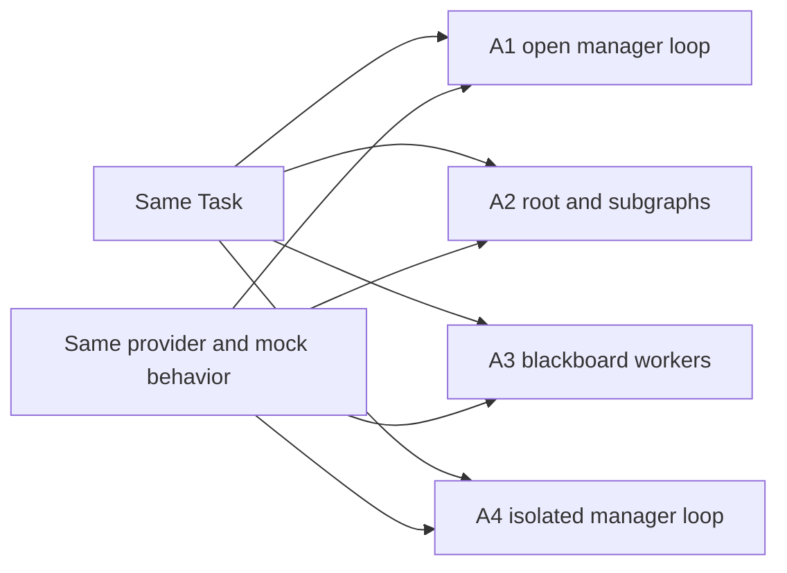

# Architecture comparison notes

## Controlled task and agent seam

All four runners receive the same `Task` instance and can receive one shared
registry from `agents/provider.py`. The registry includes the three controlled
worker roles:

- `evidence_verifier`
- `quantitative_verifier`
- `validity_verifier`

The mock outputs are deterministic. Architecture-specific supervisors and
synthesizers are also created by the same provider so no architecture imports
a model implementation directly.

## Information-flow hypotheses

| Architecture | Manager/supervisor | Worker peer results | Shared state |
| --- | --- | --- | --- |
| A1 | Dynamic team lead | Visible to later workers | Open manager/team context |
| A2 | Root plus sub-team supervisors | Explicit graph state | Parent/subgraph state |
| A3 | No task-routing supervisor | Workers use board snapshots | Structured blackboard |
| A4 | Dynamic team lead | Explicitly excluded | Manager-only accumulated results |

The result envelope is common, but call counts are expected to differ because
hierarchical supervisors are part of A2 and board synthesis is part of A3.
A1 and A4 use the same worker order and round limit; their intended difference
is worker context visibility.

## Deletion rule

An architecture folder may import `common/` and `agents/`, and may use the
neutral evaluation layer. It must not import another architecture folder. The
evaluation runner uses lazy imports and records unavailable architectures, so a
selected architecture can remain runnable after others are removed.
