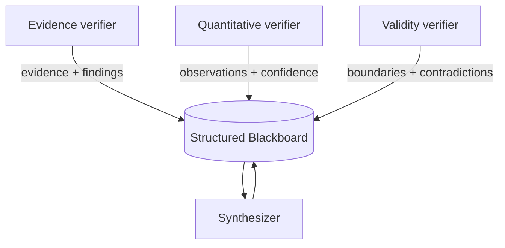

# A3 — Agent Team + Shared Evidence State / Blackboard

This architecture coordinates through structured shared state. There is no
Magentic manager or supervisor selecting the workers.



Each worker reads a defensive board snapshot containing the task and source
evidence, then writes typed evidence, findings, confidence, contradictions,
and provenance. The synthesizer reads the complete board and its final finding
is linked back to the board evidence. Peer chat histories are not used as the
coordination channel.

The blackboard is a custom Python architectural pattern. Its state model is
inspired by the Downloads reference implementation and is intentionally not
forced into LangGraph or Microsoft Agent Framework.

Files:

- `blackboard.py`: structured state and explicit read/write methods.
- `architecture.py`: worker fan-out, publication, and synthesis.
- `run.py`: standalone entry point.

Run from `agent-arch/`:

```text
python -m agent_arch_experiments.architectures.blackboard_team.run
```

Agents are obtained from `agents/provider.py`. Real agents can replace the
mock registry without changing this folder, as long as they return the common
`AgentResult` shape.

Unique dependency: none beyond Python. No Microsoft or LangGraph package is
needed for this architecture.

Limitation: the prototype uses in-process state and no durable database. The
board is reproducible for one run but is not a production persistence layer.
