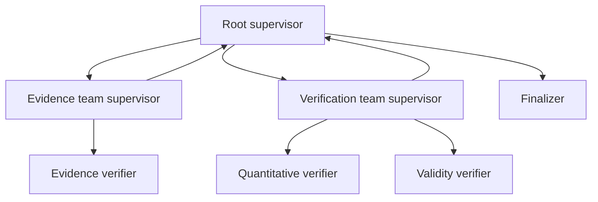

# A2 — Hierarchical Multi-Agent using LangGraph

This folder implements a genuine hierarchy with a root graph and two compiled
subgraphs. It is not a sequential wrapper around three Python calls.



The parent `StateGraph` routes to compiled evidence and verification
subgraphs. Each subgraph has its own typed state and supervisor node. The
verification supervisor delegates first to the quantitative verifier and then
to the validity verifier. The root supervisor receives subgraph results and
chooses the next subgraph or finalizer.

The implementation follows the current LangGraph `StateGraph`, conditional
edge, and compiled-subgraph patterns. The node functions, shared result
envelope, and trace bridge are custom experiment code. The graph is built only
after the optional LangGraph dependency is available.

Files:

- `state.py`: parent and subgraph `TypedDict` schemas.
- `graph.py`: graph construction, nodes, routing, and Mermaid representation.
- `architecture.py`: common `ArchitectureResult` wrapper.
- `run.py`: standalone entry point.

Run from `agent-arch/`:

```text
python -m pip install -e ".[langgraph]"
python -m agent_arch_experiments.architectures.hierarchical_langgraph.run
```

Agents come from `agents/provider.py`. Replacing them does not require changes
in this folder, provided the replacement implements the common agent contract.

Unique dependency: `langgraph`.

Limitation: the current mock routing is deterministic; model-driven supervisor
decisions and persistence/checkpointing are left for later experiments.
