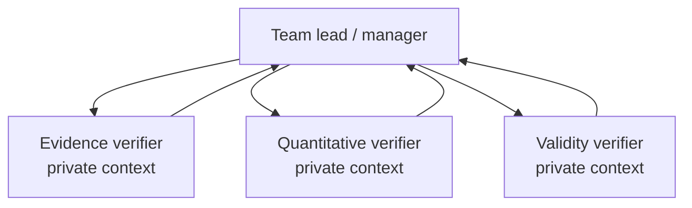

# A4 — Magentic + Context Isolation

This folder isolates application-visible worker context while keeping the
manager-led control flow comparable to A1.



The manager can see all returned `AgentResult` objects and uses them for final
synthesis. Every worker receives only the task, explicitly allowed source
evidence, selected global metadata, and its objective. `ContextPolicy` creates
a fresh packet and records a `ContextAudit`; peer results and peer message
histories are not copied into worker contexts.

The isolation coordinator is custom experiment code because the current
Microsoft `MagenticBuilder` API does not expose a documented per-worker
application-context policy hook. Using the builder without such a hook would
not prove isolation. This project therefore labels the offline coordinator
honestly and keeps the official Magentic integration in A1 as the API baseline.
This concerns application-visible messages and outputs only, not hidden
chain-of-thought.

Files:

- `context_policy.py`: allow-list context builder and audit checks.
- `architecture.py`: comparable manager loop with isolated workers.
- `run.py`: standalone entry point.

Run from `agent-arch/`:

```text
python -m agent_arch_experiments.architectures.magentic_context_isolation.run
```

Agents come from `agents/provider.py`; replacing mock agents does not require
changes here. Keep returned structured results compatible with `AgentResult`.

Unique dependency: none for the offline implementation.

Limitation: a real official Magentic isolation implementation requires a
framework-supported context interception/custom-executor API or a future
adapter. The current tests prove the local application boundary, not hidden
model state.
