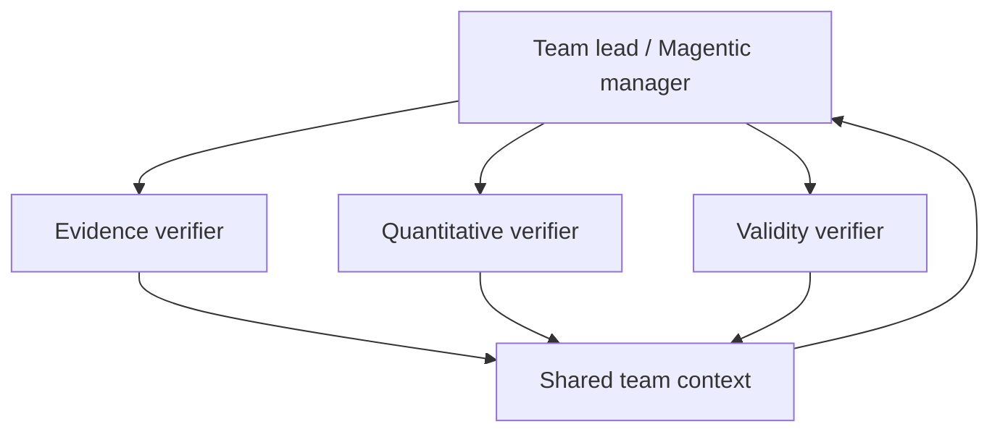

# A1 — Magentic Team Lead + Agent Team

This folder models a manager-led team with open application-visible worker
context.



The offline `MagenticTeamArchitecture` uses the same manager/worker decision
shape as Magentic: plan, select a worker, observe progress, and synthesize.
Prior worker `AgentResult` objects are explicitly visible to later workers.
The deterministic coordinator exists for reproducible tests and is not the
Microsoft framework implementation.

`OfficialMagenticRunner` uses the current Microsoft Agent Framework
`MagenticBuilder` through the thin adapter in `agents/adapters/`. It requires
official framework participant objects and a real model client. It does not
pretend that offline mock agents are official framework agents.
The adapter follows the verified current builder signature and uses
`intermediate_output_from="all_other"`; it does not use the older
`intermediate_outputs=True` spelling.

Files:

- `architecture.py`: offline coordinator and opt-in official runner.
- `run.py`: standalone offline entry point.

Run from `agent-arch/`:

```text
python -m agent_arch_experiments.architectures.magentic_team.run
```

Both paths obtain offline agents from `agents/provider.py`. Replacing mock
agents requires changing that provider only; this folder should not change.

Unique dependency: the official path uses the optional `magentic` dependency
group. Offline execution has no external dependency.

Limitation: the official runner needs a configured model-backed Microsoft
Agent Framework client, and its observed call count is not a token-usage
metric.
