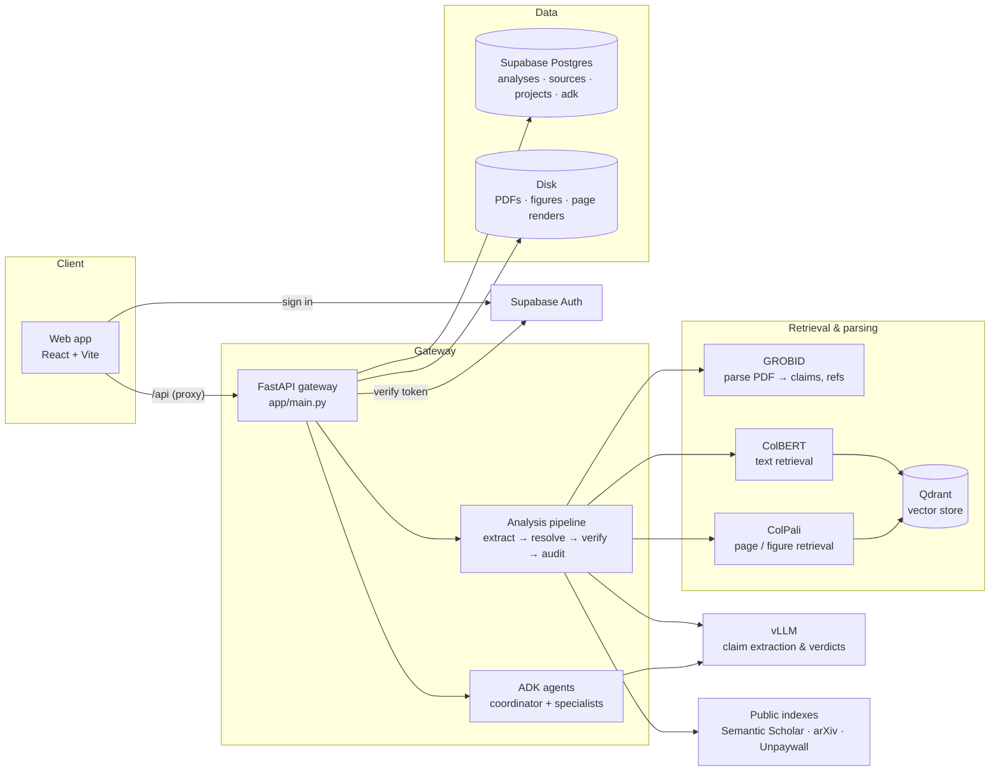
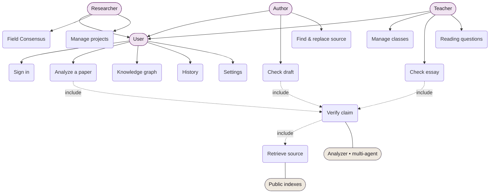
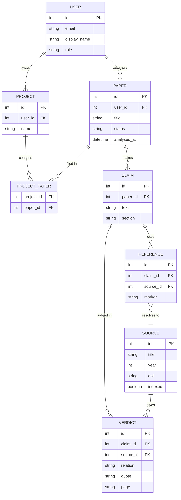
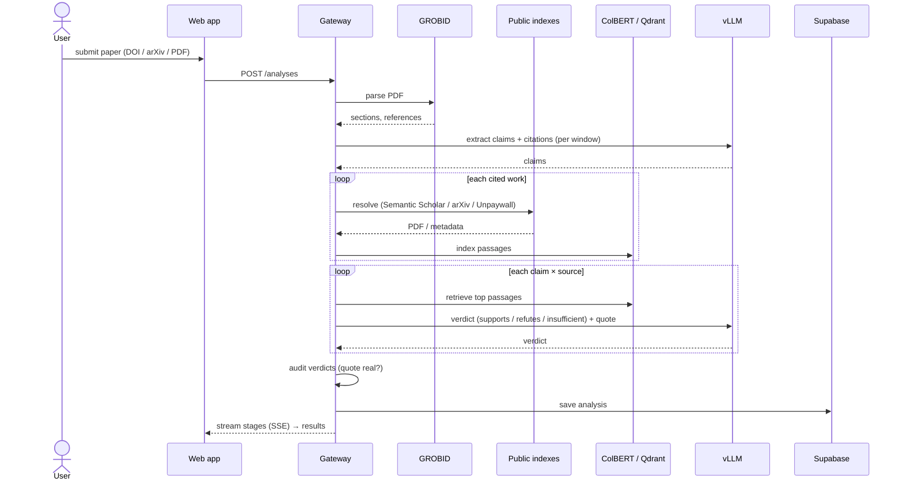
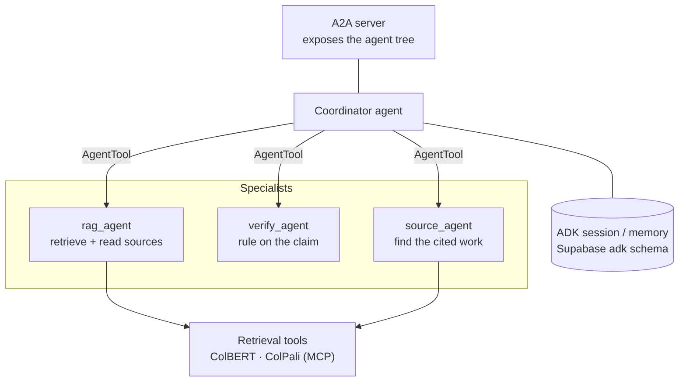
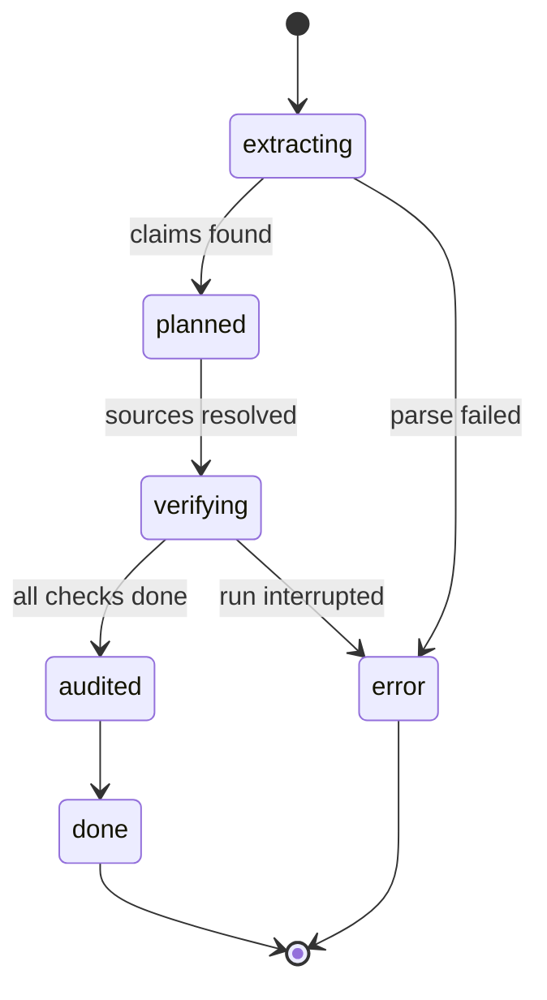
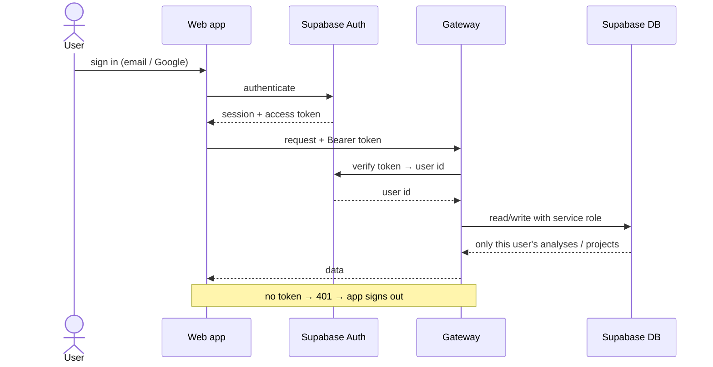
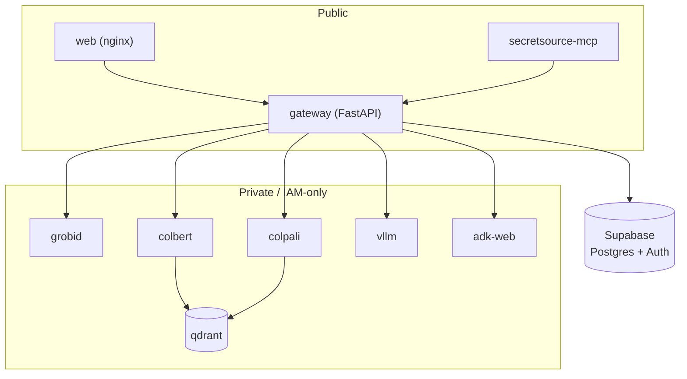

# SecretSource — Diagrams

Every diagram below is Mermaid, so GitHub renders it on this page. Static PNG copies for
slides / the report are in [`docs/img/`](img/).

SecretSource is a multi-agent, multimodal citation-verification tool: give it a paper and it
extracts each claim, finds the works that claim cites, and checks whether those sources actually
support the claim — returning per-claim verdicts, a field-consensus view, and a knowledge graph.

---

## 1. System architecture

## 2. Use-case diagram

Researcher / Author / Teacher inherit a base **User**, so the shared use cases apply to every
role. **Graph** and **History** aggregate every role's work — one account can hold several roles.

## 3. Domain model — logical ER (normalized)

The domain in third normal form. The paper↔project many-to-many is resolved by the
**PROJECT_PAPER** join entity; a **REFERENCE** (an in-text citation) resolves to a deduplicated
**SOURCE**; each (claim, source) pair yields one **VERDICT**.

## 4. Physical storage (as built, Supabase)

The gateway stores each analysis as one JSON document rather than the normalized tables above —
it reads and writes whole analyses, and it matches the ADK runtime. So the logical entities
(CLAIM, REFERENCE, VERDICT …) live **inside** `analyses.data`. Three blob tables in `public`
plus the ADK-managed `adk` schema for chat sessions.

> No DB-level foreign keys: rows are opaque JSON, access is filtered in the gateway (analyses by
> the `owner` inside `data`, projects by the `owner` column). RLS is on with no policies; the
> gateway connects with the service role.

## 5. Analyze-a-paper pipeline (sequence)

## 6. Multi-agent architecture

## 7. Analysis lifecycle (state)

## 8. Authentication & per-user access

## 9. Deployment (Docker Compose services)

