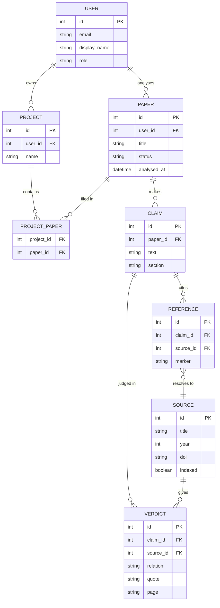
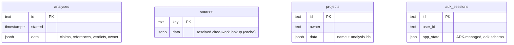

# SecretSource — ER Diagram

The data model, as Mermaid so GitHub renders it. Two views: the **logical model** (how the
domain is normalized) and the **physical storage** (how the gateway actually keeps it). PNG
copies are in [`docs/img/`](img/): [logical](img/er-logical.png) · [physical](img/er-physical.png).

## Logical model (normalized)

Third normal form. The paper↔project many-to-many is resolved by the **PROJECT_PAPER** join
entity; a **REFERENCE** (an in-text citation) resolves to a deduplicated **SOURCE**; each
(claim, source) pair yields one **VERDICT**.

## Physical storage (Supabase, as built)

The gateway stores each analysis as one JSON document rather than the normalized tables above —
it reads and writes whole analyses. So the logical entities (CLAIM, REFERENCE, VERDICT …) live
**inside** `analyses.data`. Three blob tables in `public` plus the ADK-managed `adk` schema for
chat sessions.

> No DB-level foreign keys: rows are opaque JSON, access is filtered in the gateway (analyses by
> the `owner` inside `data`, projects by the `owner` column). RLS is on with no policies; the
> gateway connects with the service role.
