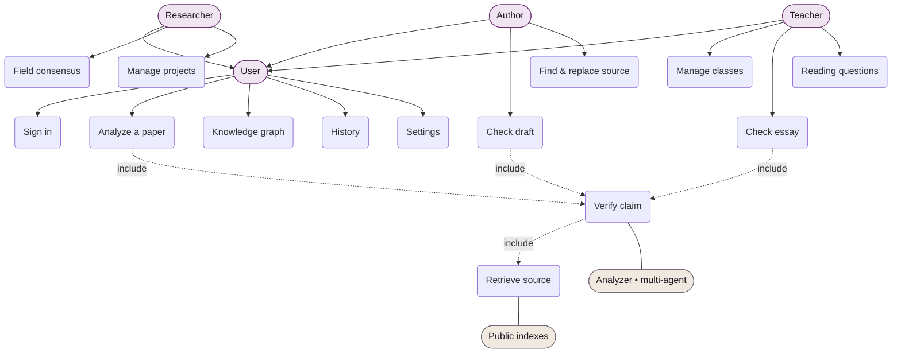
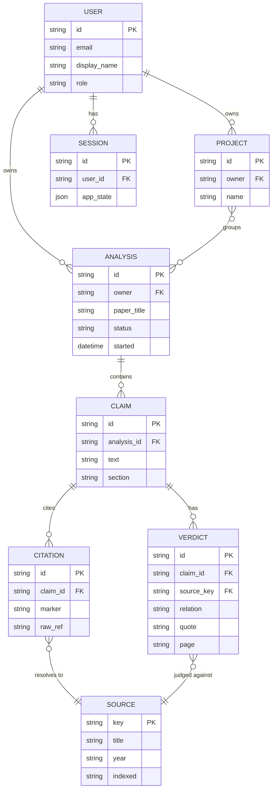

# SecretSource — Diagrams

GitHub renders the Mermaid blocks below automatically — edit the code fences to update.
Static PNG copies (for slides / the report) live in [`docs/img/`](img/): [use-case](img/usecase.png) · [ER](img/er.png).

## Use-case diagram

Roles inherit a shared **User** actor, so every role gets the shared use cases
(**Analyze a paper, Knowledge graph, History, Sign in, Settings**). Graph and History
aggregate every role's work — one account can hold several roles.

## ER diagram

Conceptual (normalized) domain model. The implementation stores it as JSON blobs
(`analyses.data`, `sources`, `projects`) plus the `adk` session schema — a deliberate
build-speed vs. queryability trade-off.

